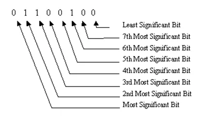
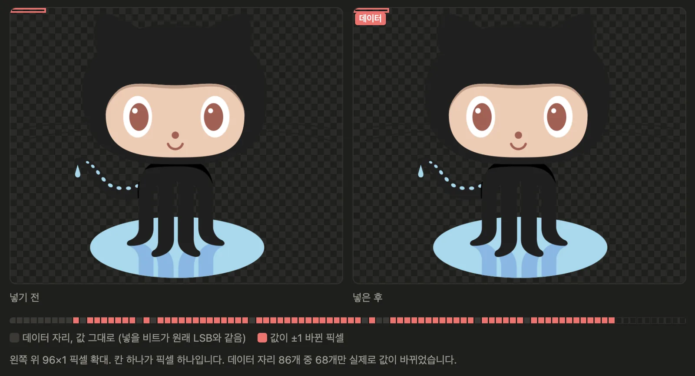

## 이미지 데이터 구조 
JPG, GIF, PNG, WEBP 등 여러 이미지 포멧들은 이미지의 크기, 색상 등을 각자의 확장자 구조에 맞춰 정보를 압축하여 바이트로 구성된 파일로 만듭니다. 확장자 구조에 맞춰 이미지가 실행되는 환경마다 있는 디코더를 통해 각 픽셀별로 색을 표현할 RGB 값을 찾아냅니다.
하지만 확장자랑 실제 내부 파일구조가 다를 수 있으므로 일반적으로 아래와 같은 처리를 따릅니다.
- 1. 파일 형식 식별: 파일 내부의 시그니처나 헤더 등을 통해 어떤 형식인지 확인
- 2. 파일 구조 해석: 이미지 크기, 색상 유형, 압축 데이터의 위치 등을 파악
- 3. 디코딩: 해당 형식의 압축, 부호화된 데이터를 복원
- 4. 픽셀 버퍼 구성: 필요에 따라 RGB나 RGBA 등으로 변환

PNG 기준으로 하나의 채널당 8비트 즉 0부터 255까지의 값을 지닙니다. 
아주 친숙한 숫자죠, css 할때 자주 보던 #ffffff나 방식이 이거죠, f가 16까지 나태낼 수 있으니 2칸으로 0~255를 나타내는 것처럼 픽셀의 색상은 그 RGB 기준을 따릅니다. PNG에 경우 A 채널도 더할 수 있죠.

LSB 알고리즘에서는 255 값이나 ff 값과 같이 1111 1111 형태의 값도 나오게 되는데
이 셋은 전부 같은 값이죠. 이 값이 R에 위치하면 빨강색 정도가 가장 강한걸 의미하게 됩니다.

## LSB 
LSB(Least Significant Bit)는 픽셀을 구성하는 채널 값의 최하위 비트를 변경해 정보를 숨기는 기법으로 이 자체가 워터마크랑 동일한 의미라기보다는 이 기술을 이용해 정보를 삽입합니다.
그래서 정보를 삽입하는 방식을 LSB 치환(LSB Substitution) 알고리즘이라고 칭합니다.

LSB는 쉽게 8비트에서 가장 하위 비트를 지칭하는거야 쉽습니다.

하나의 픽셀 RGB에서 값을 1111 1111로 값을 표시한다고 가정하면 여기에 마지막 값을 0 또는 1로 수정함으로써 정보를 저장하는 방식으로 그렇기에 RGB 3개의 채널에 값을 저장하므로 3비트의 값이 한 픽셀마다 가져올 수 있게 됩니다. 

### 값넣는 방법
1. 2로 나누고 나머지를 버려서 LSB에 들어가는 숫자를 없앤 후 정보 값을 더하기

\[
\boxed{V' = V - (V \bmod 2) + b}
\]

2. 마스크를 만든 후 & 연산으로 LSB를 없앤 뒤 정보 값을 | 연산으로 더하기

\[
\boxed{V' = (V \mathbin{\&} 254) \;|\; b}
\]

- \(V\): 원본 채널 값 (0~255)
- \(V'\): 변경된 채널 값
- \(b\): 저장할 비트 (0 또는 1)
- &: 비트 AND 연산
- |: 비트 OR 연산
- 254: 이진수 11111110 (마지막 비트를 0으로 만드는 마스크)

### 사용
깃허브 이미지에 제 블로그 주소를 넣어보도록 하겠습니다.
이 부분에서 워터마크를 만드는 법은 간단합니다, 읽는 쪽 넣는 쪽이 동일한 규칙으로 값을 가져오면 되죠
0,0 픽셀값이 길이 헤더를 넣고 그 다음 부터 나오는 RGB채널의 각 마지막 LSB에 비트를 넣어서 아스키 코드로 제 블로그 주소를 넣었습니다.

| 구간 | 비트 번호 | 위치 | 내용 |
| --- | --- | --- | --- |
| 길이 헤더 | 0 ~ 31 | (0,0) R ~ (10,0) G | 00000000 00000000 00000000 00011100 = 28 |
| 메시지 | 32 ~ 255 | (10,0) B ~ (85,0) R | 28 × 8 = 224비트 |

그래서 결과적으로 다음처럼 읽죠.

| 비트 | 문자 |
| --- | --- |
| 01101000 | h |
| 01110100 | t |
| 01110100 | t |
| 01110000 | p |

… 24바이트를 같은 방식으로 차례대로 읽으면 제 주소가 나오죠 https://dseung001.github.io/

### 워터마킹? 스테가노그래피?
LSB은 값을 저장하는 방법이라서 여러가지로 쓰일 수 있습니다.
정보 은닉이 가능하다는 점 덕분에 워터마크에도 쓸 수 있지만 단점이 정확하죠. 정보 은닉에서도 기본적으로 쓰이는 개념이고요.

| 구분 | 디지털 워터마킹 | 스테가노그래피 |
| --- | --- | --- |
| 목적 | 소유권 표시, 출처 확인, 무결성 검증 등 | 비밀 메시지의 존재를 숨김 |
| 삽입 정보 | 소유자 ID, 식별자, 인증 정보 | 텍스트, 파일, 비밀 메시지 |
| 중요 특성 | 목적에 따라 강인성과 검출 가능성 | 은닉성, 탐지 회피 |
| LSB 사용 | 가능하지만 변형에 취약 | 기초적인 방법으로 널리 설명됨 |

## 성능 평가 지표
쓰는 법은 간단한데, 어떤 비트에 넣어야할까, 어떤 방식의 포멧을 써야할까?
어떻게하면 더 많은 정보를 숨길 수 있을까 등 여러가지 의문이 생길 수 있는데 이를 위해서 다음 지표들을 토대로 분석합니다.

단순히 LSB를 변경하고 메시지를 추출하는 것만으로는 알고리즘이 얼마나 효과적인지 평가하기 어렵기 때문에 특히 LSB 기반 워터마킹에서는 다음 세 가지 사이의 균형을 봐야합니다.
- 비가시성(Imperceptibility): 원본 이미지와 얼마나 비슷한가?
- 강인성(Robustness): 이미지가 변형되어도 워터마크를 복원할 수 있는가?
- 삽입 용량(Capacity): 얼마나 많은 정보를 저장할 수 있는가?

### PSNR (Peak Signal-to-Noise Ratio): 이미지 품질
MSE(평균제곱오차)의 값을 사용하는데, MSE는 채널에 변경된 차이로 차이가 많아질 수록 커지는 데 이를 이용한것이 PSNR, PSNR은 이를 이용해 이미지의 오차가 얼마나 작은지를 데시벨(dB)로 표현한 값이다. 

오차가 적어질 수록 PSNR이 커지는 구조롤 지니고 log의 특징상 MSE가 10배 증가할 때마다 PSNR이 10dB씩 감소하는 구조
\[
PSNR = 10\log_{10}\left(\frac{255^2}{MSE}\right)
\]
### SSIM (Structural Similarity Index): 구조적 유사성
밝기,대비,구조 3가지 값을 수치화한 것으로 각각의 수식을 통해 값을 도출 
- 밝기(Luminance): 평균적으로 얼마나 밝은가?
- 대비(Contrast): 밝은 부분과 어두운 부분의 차이가 얼마나 큰가?
- 구조(Structure): 밝고 어두운 부분의 배치 패턴이 얼마나 비슷한가?

요소	계산에 사용하는 값	의미
밝기 \(l\)	평균 \(\mu\)	전체적으로 얼마나 밝기가 비슷한가?
대비 \(c\)	표준편차 \(\sigma\)	밝고 어두운 값의 퍼짐이 비슷한가?
구조 \(s\)	공분산 \(\sigma_{xy}\)	밝고 어두운 위치의 변화 패턴이 비슷한가?

각각의 공식은 다음과 같이 나옴

밝기 비교
\[
l(x,y)=\frac{2\mu_x\mu_y+C_1}{\mu_x^2+\mu_y^2+C_1}
\]

대비 비교
\[
c(x,y)=\frac{2\sigma_x\sigma_y+C_2}{\sigma_x^2+\sigma_y^2+C_2}
\]

구조 비교
\[
s(x,y)=\frac{\sigma_{xy}+C_3}{\sigma_x\sigma_y+C_3}
\]

여기서 \(C_1,C_2,C_3\)는 분모가 0이 되는 등의 문제를 방지하는 안정화 상수로 일반적으로 \(C_3=C_2/2\)를 구해서 사용 
최종 SSIM은 기본 설정에서 세 결과를 곱해 계산해서 SSIM 도출하는데, 필요할 때 찾아서 써야겠군요.
\[
\boxed{SSIM(x,y)=l(x,y)\times c(x,y)\times s(x,y)}
\]

### BER (Bit Error Rate): 워터마크 복원 정확도
지금은 값을 넣고, 추출했지만 서비스화했을 경우 값이 외부 이유(인터넷상황, 파일 수정등등)으로 바뀔 수 있으니 이를 수치화하는 지표 
\[
BER = \frac{\text{틀린 비트 수}}{\text{전체 비트 수}}
\]
### Capacity: 삽입 용량
비트를 상황에따라 추가하거나 삭제하는 과정에서 추가된 용량

### 정리

| 지표 | 값 | 측정 대상 | 해석 |
| --- | --- | --- | --- |
| PSNR | 89.48 dB | 이미지 품질 | 원본 대비 픽셀 오차. 40dB 이상이면 눈으로 차이를 느끼기 어려움 |
| SSIM | 0.9999998 | 구조적 유사성 | 밝기, 대비, 구조가 얼마나 같은지. 1이면 동일 |
| BER | 0.0000 | 워터마크 복원 정확도 | 훼손과 압축 이후의 복구 시나리오는 아직 하지 않았고, 다음에 확인할 예정 |
| Capacity | 28 / 199,496 bytes | 삽입 용량 | 사용 0.0140%, 픽셀당 3비트(R, G, B LSB) |

## 참고 자료
- 이미지 표현은 [PNG 4.2 Images](https://www.w3.org/TR/png-3/#4Concepts.Sourceimage), 샘플 깊이는 [4.4.5 Sample depth scaling](https://www.w3.org/TR/png-3/#x4-4-5-sample-depth-scaling), 무손실 압축은 [10. Compression](https://www.w3.org/TR/png-3/#x10-compression)에서 확인한다.
- 워터마킹 성질의 정의는 [Nyeem 등의 4장](https://asp-eurasipjournals.springeropen.com/articles/10.1186/1687-6180-2014-135#Sec10)에 있다.
- PSNR(Peak Signal-to-Noise Ratio, 최대 신호 대비 잡음 비율)의 한계와 SSIM(Structural Similarity Index, 구조 유사도)은 [Wang 등의 논문](https://ece.uwaterloo.ca/~z70wang/publications/ssim.pdf)에서 본다.
- PSNR, SSIM, MSE(Mean Squared Error, 평균 제곱 오차)의 계산식은 [scikit-image Metrics](https://scikit-image.org/docs/stable/api/skimage.metrics.html)에 있다.