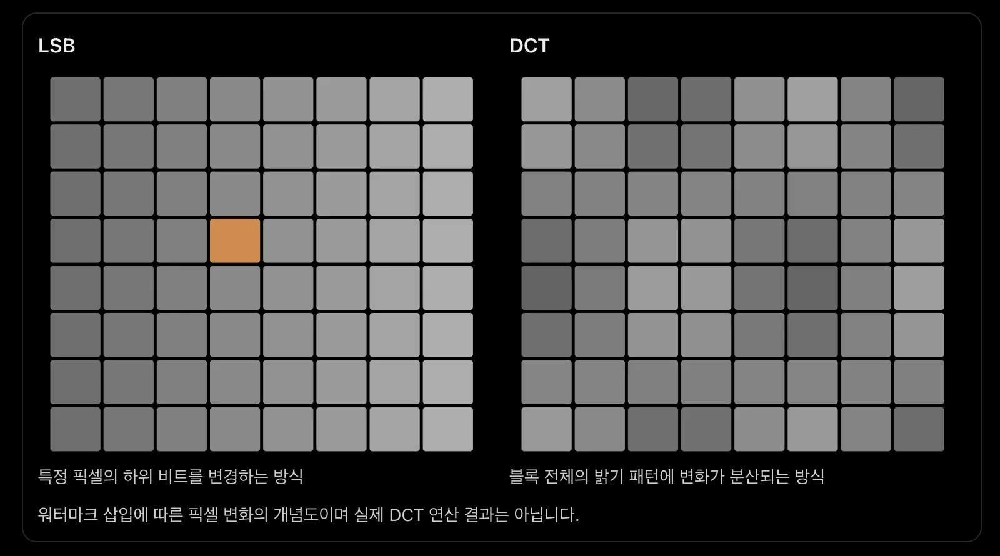
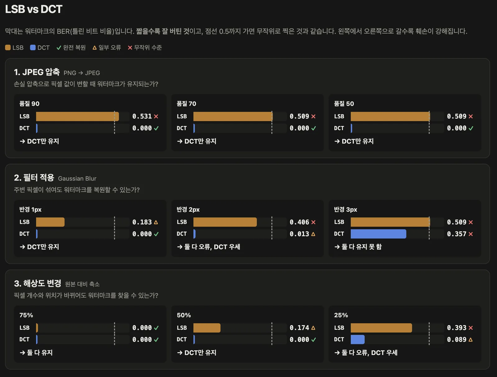

## 워터마크를 훼손하면 어떻게 될까?
[1편](/posts/2026/10/30/01-image-data-hiding/)의 LSB를 통해 비트에 값을 담워 사용자가 원하는 값을 이미지에 안보이게 담을 수 있게 되었습니다.
이걸 시스템에 대입해보면 시스템마다 버전이나, 사용자 식별번호에 워터마크 전용 식별자를 넣어서 구분한다고 보면 쉽게 노출 경로를 파악하는데 도움이 되는 워터마크 시스템을 뚝딱 만들 수 있겠죠.

하지만 저같이 LSB의 기본 개념을 알고 있다면은 이미지를 살짝만 다운사이징, 업사이징, 필터 등의 살짝의 조정으로도 이 워터마크 값은 크게 훼손될겁니다. 

### 훼손해보기 
그래서 아래와 같은 방법으로 [1편](/posts/2026/10/30/01-image-data-hiding/)에서 만든 LSB의 워터마크를 훼손해봅시다.
| 실험 | 방법 | 확인할 내용 |
| --- | --- | --- |
| 1. JPEG 압축 | PNG → JPEG (품질 90, 70, 50) | 손실 압축으로 픽셀 값이 변할 때 워터마크가 유지되는가? |
| 2. 필터 적용 | Gaussian Blur (반경 1, 2, 3px) | 주변 픽셀이 섞여도 워터마크를 복원할 수 있는가? |
| 3. 해상도 변경 | 원본의 75%, 50%, 25%로 축소 | 픽셀 개수와 위치가 바뀌어도 워터마크를 찾을 수 있는가? |

### 강인성 측정
훼손해보며 LSB의 강인성을 측정해봅시다.
일반적으로 BER(Bit Error Rate) 과 복원 성공률(Success Rate) 을 이용해 평가하므로 여기서도 동일하게 적용합니다.

\[
BER=\frac{N_{\mathrm{error}}}{N_{\mathrm{total}}}
\]

- \(N_{\mathrm{error}}\): 잘못 복원된 비트 수
- \(N_{\mathrm{total}}\): 전체 비트 수

BER은 0에서 1 사이의 비율입니다. 100을 곱하면 퍼센트가 됩니다. 예를 들어 원본을 JPEG로 압축한 뒤 추출하면 다음과 같습니다.

| 자리 | 1 | 2 | 3 | 4 | 5 | 6 | 7 | 8 |
| --- | --- | --- | --- | --- | --- | --- | --- | --- |
| 원본 | 1 | 0 | 1 | 1 | 0 | 1 | 1 | 0 |
| 추출 | 1 | 0 | 1 | **0** | 0 | 1 | **0** | 0 |
| 판정 | 일치 | 일치 | 일치 | 손상 | 일치 | 일치 | 손상 | 일치 |

전체 8비트 중 2비트가 손상되었습니다.

\[
BER=\frac{2}{8}=0.25,\qquad 0.25\times 100=25\%
\]

BER이 낮을수록 강인성이 높다고 평가할 수 있습니다.

강인성을 이해하기 쉽게 표현하기 위해 다음과 같은 비트 정확도를(BitAccuracy)을 사용할 수도 있습니다. 이 식의 BER은 위에서 구한 비율 0.25입니다.

\[
\mathrm{BitAccuracy}=(1-BER)\times 100=(1-0.25)\times 100=75\%
\]

## DCT(Discrete Cosine Transform)
LSB와 같이 DCT도 해보며 비교할 예정입니다.

DCT는 이미지의 픽셀 밝기 정보를 주파수 성분으로 변환하는 기법입니다. 
이미지를 일정한 크기(예: 8×8)의 블록으로 나누고 각 블록에 포함된 픽셀들의 밝기 변화 패턴을 분석하여 주파수 계수를 구합니다.
- **저주파:** 밝기가 천천히 변하는 패턴
- **고주파:** 밝고 어두운 부분이 빠르게 반복되는 패턴
- **DC 계수:** 주파수가 0인 성분으로, 블록 전체의 평균 밝기를 나타내는 계수입니다. 정확히는 평균 밝기에 비례하는 값을 의미하며 일반적으로 평균 값인 DC 계수는 차이가 보일 수 있어 데이터 삽입을 피합니다.

이 주파수 계수를 조정하여 데이터를 삽입한 뒤 다시 역 DCT(IDCT)를 통해 주파수 영역에서 픽셀 영역으로 다시 변환하면 픽셀 값이 일부 달라지겠지만 원본 이미지와 시각적으로 유사하게 보여서 값을 은닉할 수 있습니다.

이 방식의 장점은 특정 픽셀의 비트에만 의존하는 LSB와 달리 여러 픽셀에 걸친 밝기 변화 패턴에 데이터를 삽입할 수 있기 때문에 적절한 주파수 계수와 삽입 방식을 선택하면 JPEG 압축 등의 이미지 변형에도 LSB보다 높은 강인성을 확보할 수 있습니다.

### 수식
수식은 아래와 주파수 값을 구하므로 코사인을 이용해 값을 구합니다. openCV를 통해 간단히 쓸거 같네요.
\[
\begin{aligned}
F(u,v)={}&\alpha_N(u)\alpha_M(v)\\
&\cdot\sum_{x=0}^{N-1}\sum_{y=0}^{M-1}f(x,y)\\
&\cdot\cos\left(\frac{(2x+1)u\pi}{2N}\right)
\cos\left(\frac{(2y+1)v\pi}{2M}\right)
\end{aligned}
\]

### 값의 표현
LSB는 최하위 비트라는 0, 1로 쪼개지는 값을 바꿔서 데이터를 저장했다면 DCT는 \(c_1\), \(c_2\)라는 영역별 구분값을 정의합니다. 
\(c_1\), \(c_2\)는 단순히 생각하면 무늬를 기준으로 이분법한 걸로 보시면 됩니다

※ 만약에 읽을 때 기준으로 무늬가 반반인 경우가 발생했다면 공격으로 인해 생기는 경우로 흔치 않음. 그리고 읽을 때도 문제가 되지 않도록 한쪽으로 되게 설정을 함

<figure>

<figcaption>\(c_1\)의 무늬 (좌우로 더 자주 바뀜)</figcaption>
</figure>
<figure>

<figcaption>\(c_2\)의 무늬 (위아래로 더 자주 바뀜)</figcaption>
</figure>

- \(c_1\) = 좌우로 더 자주 바뀌는 무늬가 블록에 얼마나 들어 있는가
- \(c_2\) = 위아래로 더 자주 바뀌는 무늬가 블록에 얼마나 들어 있는가

이걸로 0과 1을 구분할 수 있습니다.

- \(c_1\)이 더 크다 → 1
- \(c_2\)가 더 크다 → 0

넣고 싶은 비트와 맞지 않으면 한쪽 무늬를 조금 더하고 다른 쪽을 조금 빼서 크기 관계를 바꾸기에 변화가 아주 약해서 눈으로는 거의 보이지 않습니다. 

읽을 때는 두 숫자를 다시 구해서 어느 쪽이 큰지 보는 걸로 0, 1을 표현합니다.

## 비교

LSB와 DCT를 비교하면 다음과 같습니다. 한 픽셀을 이용하느냐, 공간을 이용하느냐가 주된 차이점이죠.
ㅇ

이전 테스트에 쓰인 이미지는 첫 줄부터 접근하면 검은색 RGB에 들어갔기 때문에, 이번에는 차이를 위해 RGB 컬러가 존재하는 부분을 기준으로 비교해봤습니다. 그래서 다음과 같이 비교 데이터가 진행되었죠.

| 항목 | LSB | DCT |
| --- | --- | --- |
| 조정 대상 | 픽셀 값의 마지막 비트 | 블록의 주파수 계수 2개 |
| 1비트가 차지하는 자리 | 채널 값 1개 | 8×8 블록 1개(64픽셀) |
| 비트 표현 방식 | 마지막 비트가 0이냐 1이냐 | c₁과 c₂ 중 어느 쪽이 크냐 |
| 픽셀 변화 | 해당 값만 ±1 | 블록 안 64픽셀 전체가 조금씩 변함 |
| 메시지 반복 | 약 2,451회 | 약 6회 |

흐름을 비교하면 이렇습니다.

- LSB: 픽셀 값 → 마지막 비트를 교체 → 끝
- DCT: 픽셀 64개 → DCT 변환 → 계수 2개의 차이를 조정 → 역변환 → 블록 전체 픽셀에 변화가 퍼짐

워터마크는 식별자 데이터만 넣으면 되니 지금까지로는 DCT 기술이 더 활용하기 좋아보이네요.