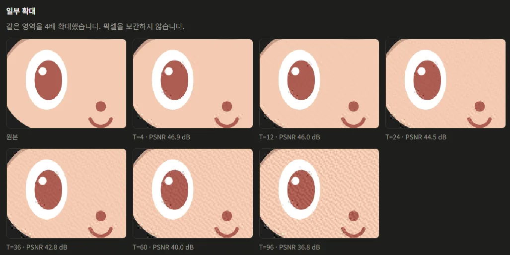
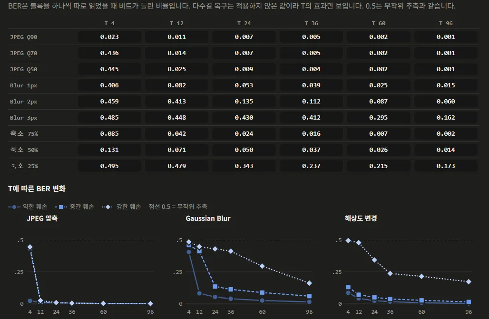

## 워터마크 훼손 복구 전략
[2편](/posts/2026/10/31/02-lsb-watermark-damage/)에서 LSB, DCT 중에서는 DCT가 어느 정도의 훼손에 더 유연하게 대처가 되는 것을 봤습니다. 
이전 [DCT로 이미지에 삽입하는 방식](/posts/2026/10/31/02-lsb-watermark-damage/#dctdiscrete-cosine-transform)에서 DCT 강도 T에 대한 부분을 생략했었는데 
이 T 값은 [2편](/posts/2026/10/31/02-lsb-watermark-damage/#값의-표현)에서 말했던 DCT에서 0과 1로 나누는 기준인 c₁과 c₂의 차이를 최소한 얼마나 차이를 가져갈지에 대한 변수로 이 값이 클수록 훼손에 잘 버팁니다.

[2편](/posts/2026/10/31/02-lsb-watermark-damage/)에서는 36으로 두고 했는데 이 값에 크기에 따라 훼손을 버티게 되지만 그만큼 이미지는 훼손되게 되는 형태입니다.

아래는 여러 T 값을 가지고 이미지에 워터마크를 넣은 케이스들입니다. [1편](/posts/2026/10/30/01-image-data-hiding/#psnr-peak-signal-to-noise-ratio-이미지-품질)에서 배운 PSNR로 이미지 품질을 보는데 40db 이상부터 괜찮은 이미지로 보곤 합니다, 해당 이미지에서는 8x8 픽셀로 DCT했을 때 기준으로 40db대에서도 눈에 띄게 차이가 생기긴 하지만 노이즈로 넘길 정도로 보이는군요.

T 값 별로 BER 수치를 측정하면 다음과 같이 나오는데 T 값이 12만 돼도 JPEG는 어느 정도 버티는 걸 볼 수 있습니다, 그 이상의 T 값들은 당연히 Gaussian Blur나 해상도 변경을 더 잘 버티지만 사람이 보기에도 이미지 훼손이 잘 보이는 단계가 사용에 제약이 발생할 거 같네요.

이 글에서 다루는 워터마크의 목적은 유출 경로 추적입니다. 
정보를 이미지에 숨겨 두면 이미지가 유출됐을 때 그 정보를 읽어 어디서 유출되었는지 알 수 있습니다.

그러려면 우선 사람 눈에는 띄지 않아야 하고 유출 과정에서 발생하는 압축이나 크기 변경을 거쳐도 메시지를 읽을 수 있어야 합니다. 그래서 화질을 지키면서 메시지를 복구할 수 있는 가장 작은 T를 찾습니다.

또 이번 포스트에서 중요한 메시지 복구 전략을 알아봅시다.

## 전략
다음 방법을 통해 훼손된 메시지를 복구할 수 있는 부분을 살릴 수 있습니다.

### 반복 삽입(Redundancy)
동일한 데이터를 여러 위치에 저장해 두는 기법으로 4비트 메시지를 이미지에 삽입한다고 봤을 경우 이미지에 DCT, LSB 방식에 넣을 수 있는 만큼 4비트 메시지를 반복해서 넣는 방식입니다.
- 장점: 구현이 단순하고 일부 복사본이 손상되어도 나머지 복사본을 활용 가능
- 단점: 반복 횟수만큼 삽입 용량이 증가하고 전체적으로 손상을 입히면 복구하기 어려움

반복 삽입 자체로는 데이터가 복구되지 않고 이를 기반으로 원본을 판단하는 추가적인 로직이 필요합니다.

### 다수결(Majority Voting)
위 반복 삽입에 다수결을 대입하여 값을 유추할 수 있습니다. 
직관적인 이름처럼 반복 삽입된 데이터들 중에서 각 비트별로 가장 많이 나온 값을 선택해서 복구하는 방식입니다.

같은 4비트 `1 0 1 1`을 여러 위치에 넣고 읽는 쪽에서는 위치마다 해당하는 비트를 가져와서 1과 0 중 표가 더 많은 쪽을 고릅니다. 추출할 수 있는 위치의 수를 홀수 개로 가져가서 동률이 나오지 않게 합니다.

| 자리 | 1 | 2 | 3 | 4 |
| --- | --- | --- | --- | --- |
| 원본 | 1 | 0 | 1 | 1 |
| 추출 1 | 1 | 0 | 1 | 1 |
| 추출 2 | 1 | 0 | 0 | 1 |
| 추출 3 | 1 | 1 | 1 | 1 |
| 1의 표 | 3 | 1 | 2 | 3 |
| 0의 표 | 0 | 2 | 1 | 0 |
| 다수결 | 1 | 0 | 1 | 1 |

구현이 쉽지만 단점으로는 JPEG같이 전체적인 압축 방식으로 여러 위치에 비슷한 작용을 미치는 경우 반복 삽입의 효과가 제한될 수 있습니다. (JPEG와 DCT 워터마킹이 같은 DCT 계수를 다루기 때문에 훼손되기 쉬움)

### 오류 정정 코드(ECC)

## LSB와 DCT에 적용
- 기존 LSB와 DCT 구현에 복구 전략을 적용하고 차이를 확인한다.
## 실험
- JPEG 압축, Blur, Resize 공격 이후 각 알고리즘의 복구 성능을 측정한다.
- BER, 완전 복구율, 삽입 용량 등을 기준으로 복구 전후 성능을 비교한다.
## 한계
- 복구가 불가능한 상황과 복구율을 높이기 위한 대가를 분석한다.
- 실험 결과를 바탕으로 실제 이미지 유출 추적 시스템에 적용할 수 있는지 판단한다