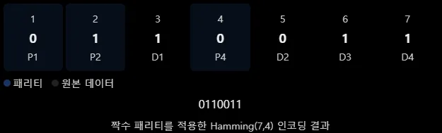
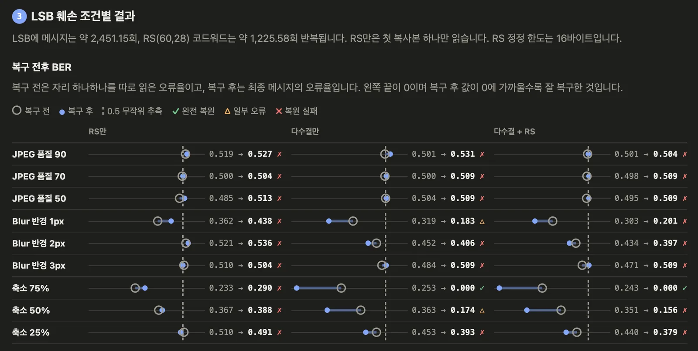
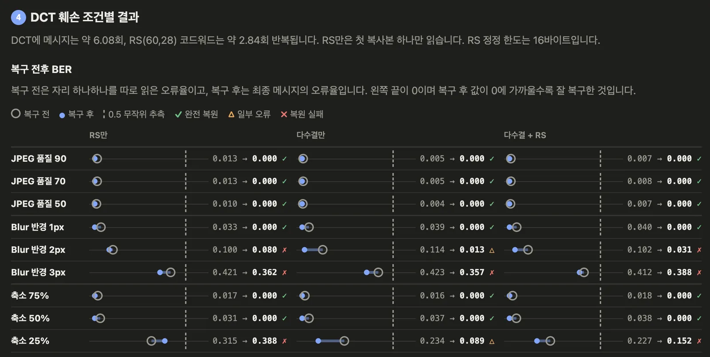

## 워터마크 훼손 복구 전략
[2편](/posts/2026/10/31/02-lsb-watermark-damage/)에서 LSB, DCT 중에서는 DCT가 어느 정도의 훼손에 더 유연하게 대처가 되는 것을 봤습니다.

이전 [DCT로 이미지에 삽입하는 방식](/posts/2026/10/31/02-lsb-watermark-damage/#dctdiscrete-cosine-transform)에서 DCT 강도 T에 대한 부분을 생략했었는데 
이 T 값은 [2편](/posts/2026/10/31/02-lsb-watermark-damage/#값의-표현)에서 말했던 DCT에서 0과 1로 나누는 기준인 c₁과 c₂의 차이를 최소한 얼마나 차이를 가져갈지에 대한 변수로 이 값이 클수록 훼손에 잘 버팁니다.

[2편](/posts/2026/10/31/02-lsb-watermark-damage/)에서는 이 T 값을 36으로 두고 했는데 이 값의 크기에 따라 훼손을 버티게 되지만 그만큼 이미지는 훼손되게 되는 형태입니다.

아래는 여러 T 값을 가지고 이미지에 워터마크를 넣은 케이스들입니다. [1편](/posts/2026/10/30/01-image-data-hiding/#psnr-peak-signal-to-noise-ratio-이미지-품질)에서 배운 PSNR로 이미지 품질을 보는데 40dB 이상부터 괜찮은 이미지로 보곤 합니다, 해당 이미지에서는 8x8 픽셀로 DCT했을 때 기준으로 40dB대에서도 눈에 띄게 차이가 생기긴 하지만 노이즈로 넘길 정도로 보이는군요.

T 값별로 BER 수치를 측정하면 다음과 같이 나오는데 T 값이 12만 돼도 JPEG는 어느 정도 버티는 걸 볼 수 있습니다, 그 이상의 T 값들은 당연히 Gaussian Blur나 해상도 변경을 더 잘 버티지만 사람이 보기에도 이미지 훼손이 잘 보이는 단계여서 사용에는 제약이 발생할 거 같네요.

이 글에서 다루는 워터마크의 목적은 유출 경로 추적입니다. 
정보를 이미지에 숨겨 두면 이미지가 유출됐을 때 그 정보를 읽어 어디서 유출되었는지 알 수 있습니다.

그러려면 우선 사람 눈에는 띄지 않아야 하고 유출 과정에서 발생하는 압축이나 크기 변경을 거쳐도 메시지를 읽을 수 있어야 합니다. 그래서 화질을 지키면서 메시지를 복구할 수 있는 가장 작은 T를 찾아야 합니다.

또 이번 포스트에서 중요한 메시지 복구 전략을 알아봅시다.

## 전략
다음 방법을 통해 훼손된 메시지를 복구할 수 있는 부분을 살릴 수 있습니다.

### 반복 삽입(Redundancy)
동일한 데이터를 여러 위치에 저장해 두는 기법으로 4비트 메시지를 이미지에 삽입한다고 봤을 경우 이미지에 DCT, LSB 방식에 넣을 수 있는 만큼 4비트 메시지를 반복해서 넣는 방식입니다.
- 장점: 구현이 단순하고 일부 복사본이 손상되어도 나머지 복사본을 활용 가능
- 단점: 반복 횟수만큼 삽입 용량이 증가하고 전체적으로 손상을 입히면 복구하기 어려움

반복 삽입 자체로는 데이터가 복구되지 않고 이를 기반으로 원본을 판단하는 추가적인 로직이 필요합니다.

### 다수결(Majority Voting)
위 반복 삽입에 다수결을 더해서 사용하면 훼손된 값을 유추할 수 있습니다. 
직관적인 이름처럼 반복 삽입된 데이터들 중에서 각 비트별로 가장 많이 나온 값을 선택해서 복구하는 방식입니다.

같은 4비트 `1 0 1 1`을 여러 위치에 넣고 읽는 쪽에서는 위치마다 해당하는 비트를 가져와서 1과 0 중 표가 더 많은 쪽을 고릅니다. 추출할 수 있는 위치의 수를 홀수 개로 가져가면 동률이 나오지 않습니다.

| 자리 | 1 | 2 | 3 | 4 |
| --- | --- | --- | --- | --- |
| 원본 | 1 | 0 | 1 | 1 |
| 추출 1 | 1 | 0 | 1 | 1 |
| 추출 2 | 1 | 0 | 0 | 1 |
| 추출 3 | 1 | 1 | 1 | 1 |
| 1의 표 | 3 | 1 | 2 | 3 |
| 0의 표 | 0 | 2 | 1 | 0 |
| 다수결 | 1 | 0 | 1 | 1 |

구현이 쉽지만 단점으로는 JPEG같이 전체적인 압축 방식으로 여러 위치에 비슷한 작용을 미치는 경우 반복 삽입의 효과가 제한될 수 있습니다. (JPEG는 이미지 전체에 같은 압축을 적용하므로 복사본들이 함께 훼손되기 쉬움)

### 오류 정정 코드(ECC)
데이터에 추가적인 정보를 넣는 방식으로 일부가 손상되더라도 복구할 수 있도록 만든 기술입니다. 넓은 의미에서는 다수결도 오류정정 코드에 포함되지만 ECC는 단순히 반복하는 것보다 효율적인 정정 방법을 가집니다.

#### 패리티 비트(Parity Bit)
패리티는 비트들이 일정한 규칙을 만족하는지 체크하는 검사로 쉬운 예시로는 짝수 패리티가 있을 수 있는데, 이는 데이터에 포함된 1의 개수가 짝수가 되도록 반드시 패리티가 추가되는 방식입니다.

이걸 통해서 훼손을 통해 1의 개수가 홀수가 되었다면 패리티 비트 체크로 알 수 있게 되는 거죠. 
하지만 이를 통해서 깨짐 여부만 파악할 수 있으므로 어디를 수정해야 할지는 알 수 없습니다.

#### Hamming Code
여러 개의 패리티 비트를 사용해 오류 발생 위치를 찾아내는 코드입니다. 
대표적으로는 **Hamming(7,4)**가 있습니다.
- 원본 데이터: 4비트
- 패리티 비트: 3비트
- 인코딩된 데이터: 7비트

패리티 비트는 1, 2, 4번에 위치하게 하는데

이를 통해 다음과 같이 패리티 비트가 특정 비트 위치를 검사합니다.

| 패리티 | 검사하는 비트 위치 |
| --- | --- |
| P1 | 1, 3, 5, 7 |
| P2 | 2, 3, 6, 7 | 
| P4 | 4, 5, 6, 7 |

패리티가 3개면 검사 결과는 2의 3승, 곧 8가지입니다. 0은 오류 없음이고, 1부터 7은 뒤집힌 비트의 자리입니다. 
위 그림의 `0 1 1 0 0 1 1`에서 5번 위치만 0에서 1로 훼손되었다고 가정합시다.

| 패리티 | 검사 위치 | 정상 데이터 | 손상 데이터 | 결과 |
| --- | --- | --- | --- | --- |
| P1 | 1, 3, 5, 7 | 0, 1, 0, 1 | 0, 1, 1, 1 | 오류 (1) |
| P2 | 2, 3, 6, 7 | 1, 1, 1, 1 | 1, 1, 1, 1 | 정상 (0) |
| P4 | 4, 5, 6, 7 | 0, 0, 1, 1 | 0, 1, 1, 1 | 오류 (1) |

P4에는 가중치 4를, P2는 2를, P1은 1을 줌으로써 이들 이진수 101의 값이 5이므로 5번째 자리가 훼손된 걸 유추할 수 있습니다, 이를 Syndrome(신드롬) 계산이라고 합니다.

이는 비트 오류 1개만 고칠 수 있어서 2개 이상이 훼손되면 정상 작동하지 않을 수 있습니다.

#### Reed–Solomon Code(RS)
위에서 단건 비트가 훼손되었을 경우에 대한 Hamming code를 봤으니 이제 심볼(여러 개) 단위로 오류를 정정하는 걸 알아봅시다, 여기서 심볼(Symbol)은 여러 비트를 하나의 데이터 단위로 묶은 걸 말하며 일반적인 RS 구현에서는 8비트(1바이트)를 하나의 심볼로 묶어서 사용합니다.

예를 들어 하나의 심볼인 `10110010`이 `01001101`로 바뀌었다면 이는 1개의 심볼 오류로 취급하는데 이를 정정할 수 있는지는 패리티 심볼의 수랑 다른 심볼의 손상 여부에 따라 달라집니다. 
※ LSB에서 DCT로 넘어간 흐름처럼 하나의 비트에서 공간 단위로 넘어가는 것입니다.

대표적으로 `RS(255,223)`이 있습니다. 얘도 다음처럼 구성됩니다.
- 원본 데이터: 223바이트
- 패리티 데이터: 32바이트
- 인코딩된 데이터: 255바이트

Reed–Solomon이 고칠 수 있는 심볼 수는 패리티 심볼의 절반입니다.

\[
t=\left\lfloor\frac{n-k}{2}\right\rfloor
\]

- \(n\): 인코딩된 전체 심볼 수
- \(k\): 원본 데이터 심볼 수
- \(t\): 정정 가능한 최대 심볼 오류 수

위에서 본 RS(255,223)은 전체 255심볼 중 원본이 223심볼이라 패리티가 32심볼이므로 그 절반인 16심볼까지 고칠 수 있습니다. 만약 손상된 위치를 정확히 알고 있는 소거(Erasure)라면 최대 32개의 심볼을 복구할 수 있습니다.

\[
t=\left\lfloor\frac{255-223}{2}\right\rfloor=16
\]

오류 위치를 찾는 방법은 다음과 같습니다. 
Hamming code에서도 패리티 검사 조합 결과를 통한 신드롬으로 위치를 찾았지만 RS에서 적용되는 신드롬은 수학적 원리가 복잡하므로 다음 단계에서 더 알아보는 걸로 남기겠습니다.

우선 전체적인 흐름을 보겠습니다.

※ 코드워드(Codeword): 원본 데이터에 오류 정정을 위한 추가 정보(패리티)를 붙여 만든 최종 데이터 단위

오류 위치를 찾기 위해 `Berlekamp–Massey` 알고리즘이나 `Chien Search` 등이 사용되며, 오류의 크기를 계산하기 위해 `Forney` 알고리즘 등이 있으며 참고해 두고 나중에 쓸 때 집중적으로 봐야겠습니다.

Hamming Code와 다른 점은 신드롬을 단순히 이진수 위치로 해석하는 것이 아니라 다항식 연산을 통해 여러 오류의 위치와 값을 계산한다는 것입니다.

## 복구해보기
LSB와 DCT에 각각 다수결 방식만 다룬 것과 다수결에 RS 방식을 더한 것을 비교해보며 복구가 어떻게 달라지는지 확인합시다. 
이전에 내용들과 조건을 동일하게 진행하여 DCT는 8x8 영역을 삼고, T는 36으로 가집니다.

아래 두 가지 방식에 에러 복구를 진행할 겁니다. 
RS(255,223)을 그대로 차용해 메시지 바이트를 28로 줄여 RS(60,28)로 사용합니다. 
DCT는 8×8 블록 1개에 1비트를 넣고, LSB는 채널 자리 1개의 최하위 비트에 1비트를 넣습니다, 횟수는 메시지 영역에 넣으려는 데이터가 몇 번이나 들어가지는지 표시합니다. LSB는 복사본마다 4바이트 길이 헤더가 붙어 실제로는 256비트, 512비트 단위로 반복됩니다. 표 수가 짝수인 비트에서 동률이 나오면 0으로 읽습니다.
| 방식 | 넣을 수 있는 칸 | 다수결. 메시지 28바이트(224비트) | RS(60,28). 코드워드 60바이트(480비트) |
| --- | --- | --- | --- |
| LSB | 627,495비트 | 약 2,451회 | 약 1,226회 |
| DCT | 1,361비트 | 약 6.08회 | 약 2.84회 |

위 방식으로 값을 넣은 뒤 훼손하고 아래의 에러 정정 방식으로 접근합니다.
1. 다수결 방식으로 비트 단위에서 에러 복구
2. RS 방식으로 바이트 단위에서 에러 복구
3. 다수결 검증으로 오류 수를 줄여 RS 방식에서 복구 가능한 16바이트 내로 줄이고 진행

각 방식의 장단점은 다음과 같습니다.

| 복구 | 장점 | 단점 |
| --- | --- | --- |
| RS만 사용 | 바이트 오류 정정 가능 | 이미지에 삽입한 복사본 정보를 활용하지 못할 수 있음 |
| 다수결만 사용 | 반복 데이터로 비트 오류 감소 | 과반수가 틀리면 복구 불가능 |
| 다수결 + RS | 서로 다른 두 단계에서 오류를 줄임 | 패리티 때문에 반복 횟수가 감소(특히 현재같이 이미지에 저장공간이 좁을 때) |

다음 9개의 케이스를 조건으로 동일하게 뒀으며 평균 BER은 조건 9가지를 각각 적용한 결과의 평균입니다.
- JPEG 품질 90, 70, 50
- Gaussian Blur 반경 1px, 2px, 3px
- 해상도 75%, 50%, 25%입니다.

| 삽입 | 복구 | 복사본 길이 | 읽는 복사본 수 | PSNR | SSIM | 완전 복원 (9조건 중) | 9조건 평균 BER |
| --- | --- | --- | --- | --- | --- | --- | --- |
| LSB | RS만 | 480비트 | 1 | 55.21 dB | 0.9994 | 0 / 9 | 0.466 |
| LSB | 다수결만 | 224비트 | 약 2,451 | 55.21 dB | 0.9993 | 1 / 9 | 0.357 |
| LSB | 다수결 + RS | 480비트 | 약 1,226 | 55.21 dB | 0.9994 | 1 / 9 | 0.352 |
| DCT | RS만 | 480비트 | 1 | 42.54 dB | 0.9786 | 6 / 9 | 0.092 |
| DCT | 다수결만 | 224비트 | 약 6.08 | 42.83 dB | 0.9789 | 6 / 9 | 0.051 |
| DCT | 다수결 + RS | 480비트 | 약 2.84 | 42.54 dB | 0.9786 | 6 / 9 | 0.063 |

이를 좀 더 자세하게 전후 비교로 시각화하면 다음과 같습니다.

### LSB 방식 시각화
현재 이미지 기준으로 LSB에서는 RS만 했을 때 대부분의 조건에서 복구 후 BER이 오히려 높게 나옵니다. 
다만 이는 RS여서 에러를 늘어난 게 아니라 비교 기준이 달라서 생긴 차이입니다. 

차트의 복구 전은 코드워드 480비트, 복구 후는 메시지 224비트의 오류율입니다. LSB는 훼손이 심해서 60바이트 중 틀린 바이트가 RS가 고칠 수 있는 16바이트를 넘게 되어 RS는 아무것도 고치지 못합니다. 

이때 복구 후 값은 훼손된 코드워드에서 메시지 부분인 앞 28바이트를 그대로 가져온 것이기에 이와 같은 결론이 나온겁니다.

### DCT 방식 시각화
DCT는 RS만 썼을 때 정정에 실패한 3가지 조건(블러 2px, 블러 3px, 축소 25%)을 제외하곤 3가지 방법 모두 수치적으로 좋게 개선되는군요.

