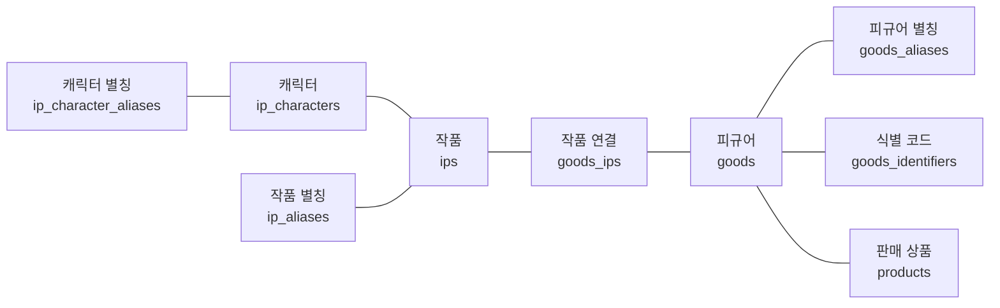
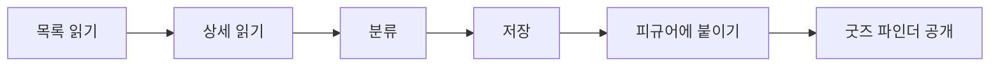
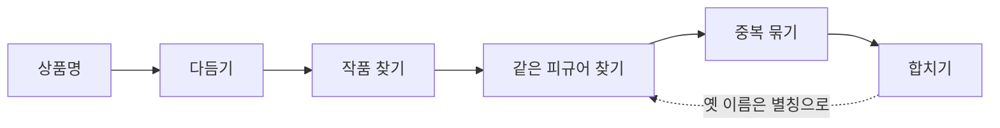
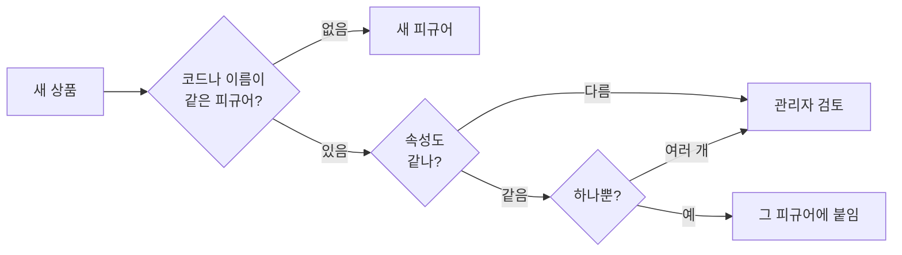
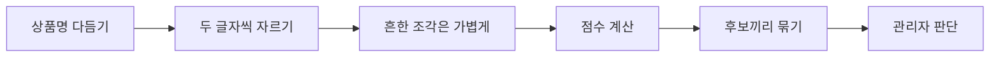
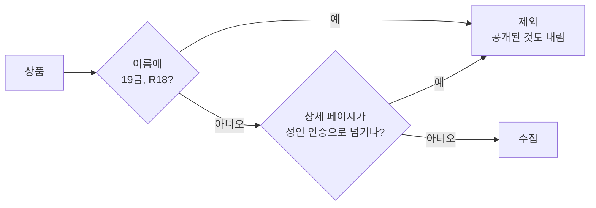

## 개요

[앞서 연 바벨모](../../../10/01/bavelmo-launch/)는 피규어를 3D 장식장에 올려 보여주는 컬렉션이었습니다. 

[프라이머 데모데이](../../../10/07/primer-demo-day/)를 포함해 여러 세미나를 거치면서, 이 방향에 대한 제 확신이 줄어들었습니다. 사용자들이 모바일에서 피규어를 놓는 가상 공간을 정말 즐겨 쓸까? 그리고 활성 사용자를 늘리기 위한 SNS 포맷이 의미가 있을까? 여기에는 확신을 가지지 못했습니다.

지난 서비스는 사용자가 시간을 내고 콘텐츠를 만들어야 쓸 수 있는 플랫폼이었는데, 그 정도의 재미를 제공하는가?, 지속 가능한 형태인가? 이라는 질문에 자신있게 대답 할 수 없었습니다. 그래서 이번에는 사용자에게 바로 이점이 보이는 사이트를 만들고자 했습니다.

여러 구인구직 사이트가 처음에는 공고 데이터를 확보하는 일부터 했던 점을 모델로 봤습니다. 
피규어라는 도메인에 그 흐름을 적용해서 사람들이 먼저 피규어 데이터를 찾는 과정부터 만들어 가며 사용자를 모으기로 생각했습니다.

서비스 주소는 그대로 https://bavelmo.com/입니다.

### 서울 대덕여지도

처음 열리는 화면은 서울 대덕여지도입니다. 
피규어를 취급하는 매장을 서울 지도 위에 모아 둔 화면입니다. 왼쪽 목록에는 매장 이름과 지역이 나오고, 지도의 마커로 매장 수를 보여줍니다. 
IP, 카테고리, 매장 이름으로 찾고 지역으로 한 번 더 좁힐 수 있습니다. 고른 매장은 방문 동선에 담아 공유할 수 있어서 간접 홍보를 노립니다.

### 굿즈 파인더

굿즈 파인더가 지금 메인이고, 여러 상품과 가격을 고르는 화면입니다. 
작품명, 캐릭터, 제조사로 검색하고, 작품 IP와 제조사, 쇼핑몰, 상품 분류, 가격대로 목록을 추릴 수 있습니다. 카드에는 가격, 판매 매장, 그 정보를 마지막으로 확인한 시각이 같이 붙어 있습니다. 
원하는 상품을 샵마다 들어가 가격을 대조하던 일을 이 화면에서 해결하는 게 목적입니다.

## 데이터베이스 구조
현재 DB 구조는 꽤나 복잡한데, IP와 IP 별칭, 제조사, 브랜드, 피규어 이름이 섞이다 보니 이렇게 되었네요.
피규어 중심으로 데이터 구조를 파악해봅시다.

<!-- 1차 자료 정리: bavelmo backend 마이그레이션 최종 스키마 기준 -->

### IP와 피규어 ERD

왼쪽이 작품(IP) 쪽, 오른쪽이 피규어 쪽입니다.

작품 하나에 별칭과 캐릭터가 여러 개 붙고, 피규어 하나에 별칭, 식별 코드, 판매 상품이 여러 개 붙습니다. 작품과 피규어는 가운데 작품 연결 테이블을 거쳐 서로 여러 개씩 이어집니다.

처음에는 테이블 이름이 figures였는데, 피규어 말고 다른 굿즈도 다루게 되면서 goods로 바꿨습니다.

### 이렇게 짠 이유

#### 1. 피규어와 판매 상품 분리

| 구조 | 이유 |
|---|---|
| 피규어(goods)와 판매 상품(products)을 따로 둠 | 같은 피규어라도 쇼핑몰마다 상품명과 가격이 다릅니다. 이름과 제조사는 피규어에 한 번만 적고, 링크와 가격은 쇼핑몰마다 판매 상품에 적습니다. 가격 비교는 피규어 하나에 붙은 판매 상품들을 모아 보면 됩니다. |
| 판매 상품이 피규어에 안 붙어 있어도 됨 | 어떤 피규어인지 확실하지 않으면 붙이지 않고 검토 대기로 둡니다. 엉뚱한 피규어에 가격이 붙는 것보다 조금 늦게 보여주는 게 낫다고 봤습니다. |

#### 2. 작품(IP) 쪽

| 구조 | 이유 |
|---|---|
| 피규어 하나에 작품 여러 개 | "원신x명조 콜라보"처럼 두 작품에 걸친 상품이 있습니다. |
| 작품 별칭 하나는 작품 하나만 가리킴 | "블루아카"를 보면 블루 아카이브, "건담"을 보면 기동전사 건담으로 바로 정해져야 자동 분류가 됩니다. |
| 캐릭터를 작품 밑에 둠 | "나히다 넨도로이드"처럼 상품명에 작품명 없이 캐릭터만 있는 경우가 많습니다. 캐릭터가 어느 작품 소속인지 알아야 작품을 붙일 수 있습니다. 같은 이름이 여러 작품에 있으면 그 이름으로는 작품을 정하지 않습니다. |

#### 3. 같은 피규어 찾기

| 구조 | 이유 |
|---|---|
| 피규어 별칭 | 쇼핑몰마다 다르게 쓴 상품명을 모아 둡니다. 두 피규어를 하나로 합치면 없어지는 쪽 이름이 별칭으로 남아서, 다음 수집부터는 그 이름이 바로 붙습니다. 디럭스판과 통상판처럼 같은 별칭이 여러 피규어에 걸리면 자동으로 붙이지 않습니다. |
| 식별 코드를 따로 둠 | 처음엔 피규어에 코드 칸이 하나였는데, JAN 코드와 제조사 품번, 재판 코드가 한 피규어에 같이 붙을 수 있어서 따로 뺐습니다. 코드가 같으면 이름보다 믿을 만해서 제일 먼저 봅니다. |

## 수집 시스템
특히 이게 개요랑 이어지는 듯합니다.

<!-- 1차 자료 정리: bavelmo backend 상품 수집 기준 -->

### 전체 흐름

매일 오전 8시에 등록된 쇼핑몰을 하나씩 돌면서 진행합니다.

| 단계 | 하는 일 | 참고 |
|---|---|---|
| 1. 목록 읽기 | 신상품, 예약 상품 목록에서 상품 링크와 가격을 모읍니다 | 성인물, 서적, DVD처럼 안 다루는 상품은 여기서 뺌 |
| 2. 상세 읽기 | 상품 페이지에서 이름, 이미지, 제조사, 식별 코드를 가져옵니다 | 하루 안에 본 상품은 건너뛰고 가격만 갱신 |
| 3. 분류 | 상품명에서 작품, 캐릭터, 제조사, 스케일을 찾아 붙입니다 | |
| 4. 저장 | 판매 상품을 새로 넣거나 갱신합니다 | 확인한 시각도 같이 저장 |
| 5. 피규어에 붙이기 | 같은 피규어가 확실할 때만 붙입니다 | 애매하면 관리자 검토 |
| 6. 공개 | 피규어에 붙은 상품이 굿즈 파인더에 가격 비교로 나옵니다 | |

쇼핑몰에 부담을 주지 않도록 요청 사이에 몇 초씩 쉬고 robots.txt를 따르며, 차단당하면 그 쇼핑몰은 바로 멈춥니다.

## 별칭, 중복 시스템
핵심 시스템

<!-- 1차 자료 정리: bavelmo backend 굿즈 매칭 기준 -->

### 전체 흐름

### 상품명 다듬기 (텍스트 정규화)

쇼핑몰은 같은 상품에도 발매일, 예약 문구, 결제 방식, 안내문을 제각각 붙입니다. 이걸 걷어내야 같은 상품끼리 이름이 맞습니다.

같은 피규어, 세 쇼핑몰의 상품명입니다.

| 쇼핑몰 상품명 | 다듬은 결과 |
|---|---|
| [26.05발매][예약특가] 프리렌 피규어 (1/1수주예약마감) | 프리렌 피규어 |
| [26.7발매][예약특가] [수량한정] 프리렌 피규어 (3/17 수주마감) | 프리렌 피규어 |
| [예약,26년12월, 27년1월 출고예정] 프리렌 피규어 | 프리렌 피규어 |

발매일과 예약 문구가 든 대괄호, 수주 마감 괄호를 지웁니다. "(1/1수주예약마감)"의 1/1은 날짜라서 스케일로 읽지 않습니다. 반대로 "프리렌 1/7 피규어"의 1/7은 스케일로 남깁니다.

결제 방식만 다른 상품은 같은 이름이 되고, 에디션이 다른 상품은 다른 이름으로 남습니다.

| 상품명 A | 상품명 B | 결과 |
|---|---|---|
| 코토부키야 GP022 제로붉은나비리메이크 오시웍스 아마쿠라미오 & 아마쿠라마유 ■ 예약금결제(20000원) | 같은 이름 ■ 전액결제 | 같은 이름 (결제 문구만 다름) |
| [예약판매][총판] 통상판 승리의여신니케 레이블 VKEND 8349 예약금 | [예약판매][총판][디럭스판] 승리의여신니케 레이블 VKEND 8349 전액결제 | 다른 이름 (통상판과 디럭스판) |
| 알터 미쿠 (제조사 알터) | 미쿠 | 같은 이름 (앞에 붙은 제조사만 지움) |
| 알터에고 미쿠 (제조사 알터) | 미쿠 | 다른 이름 ("알터에고"는 제조사가 아님) |

작품을 찾을 때는 표기도 맞춥니다.

| 상품명 | 바뀐 모습 |
|---|---|
| 미쿠 뱃지, 미쿠 키홀더 | 미쿠 배지, 미쿠 키링 |
| １ ／ ７, 1 : 7 | 1/7 |
| HG건담 원신x명조 | hg / 건담 / 원신 / x / 명조 (글자 종류가 바뀌는 곳에서 끊음) |

### 작품과 캐릭터 찾기

| 순서 | 규칙 | 예시 |
|---|---|---|
| 1 | 다듬은 상품명에서 작품명, 작품 별칭, 캐릭터명을 찾습니다 | |
| 2 | 두 글자 이름은 단어 맨 앞에 있을 때만 인정합니다 | "건담컨버지"는 건담, "스타명조"는 명조 아님 |
| 3 | 더 긴 작품명 안에 들어 있는 짧은 이름은 버립니다 | "기동전사 건담 수성의 마녀"에서 "건담"은 버림 |
| 4 | 겹치지 않으면 작품을 여러 개 붙입니다 | "원신x명조 콜라보"는 원신, 명조 |
| 5 | 한 작품에만 있는 캐릭터면 그 작품을 붙입니다 | "나히다 넨도로이드"는 원신 |
| 6 | 하나도 못 찾으면 오타를 감안해 비슷한 작품을 제안만 합니다 | "귀멸의 칼냘 키링"은 귀멸의 칼날 제안 |

캐릭터 이름이 세 글자보다 짧으면 사전에 넣지 않습니다. 짧은 이름은 엉뚱한 상품명에 걸리기 쉽기 때문입니다.

### 같은 피규어 찾기 (수집할 때)

| 확인 | 내용 |
|---|---|
| 같은 상품인가 | 식별 코드가 같거나, 별칭 또는 다듬은 이름이 같아야 합니다 |
| 속성이 맞는가 | 제조사, 스케일, 에디션, 색상, 판매 단위가 서로 달라선 안 됩니다 |
| 이름만 같을 때 | 제조사, 분류, 판매 단위, 에디션이 모두 확인돼야 붙입니다. 이름만 같아서는 붙이지 않습니다 |

### 중복 묶기 (관리자 검토)

수집할 때 놓친 중복은 이미 만들어진 피규어끼리 비교해서 찾습니다.

예를 들어 두 쇼핑몰의 같은 프라모델입니다.

| | 피규어 A | 피규어 B |
|---|---|---|
| 원래 이름 | [예약판매][총판] ARKFRAME A-07 아누비스 프라모델 스네일쉘 | 스네일쉘 ARKFRAME A-07 아누비스(프라모델) |
| 다듬은 이름 | arkframe a 07 아누비스 | 거의 같음 |
| 두 글자 조각 | ar, rk, kf, fr, ra, am, me, ea, a0, 07, 7아, 아누, 누비, 비스 | 거의 같음 |
| 점수 | 0.9 이상, 후보 | |

단어 순서와 제조사 위치가 달라도, 판매 문구와 제조사, "프라모델" 같은 군더더기를 빼고 두 글자씩 자르면 남는 조각이 거의 같습니다.

조각마다 무게가 다릅니다. "붕괴 스타레일 타이니 캣 아크릴 키링"처럼 여러 상품에 나오는 조각은 가볍고, "케리드라"처럼 드문 조각은 무겁습니다. 그래서 시리즈 이름만 겹치는 상품은 점수가 낮게 나옵니다. 이렇게 드문 단어에 무게를 더 주는 방식을 IDF라고 합니다.

| 피규어 A | 피규어 B | 결과 |
|---|---|---|
| 알터 우마무스메 프리티 더비 아그네스 타키온 1/7 완성품 피규어 | [알터][우마무스메 프리티 더비] 아그네스 타키온 1/7 | 후보 |
| 하비사쿠라 승리의 여신 니케 아니스 디럭스판 | 하비사쿠라 승리의 여신 니케 아니스 통상판 | 제외 (에디션이 다름) |
| 명조 모니에 1/6 스케일 | 명조 모니에 1/7 스케일 | 제외 (스케일이 다름) |
| 블루아카이브 노아 파자마 (코토부키야) | 블루아카이브 노아 파자마 (굿스마일컴퍼니) | 제외 (제조사가 다름) |
| 같은 쇼핑몰: 베르세르크 쿠리파크 GECCO 잔금결제 | 같은 쇼핑몰: 베르세르크 쿠리파크 GECCO 전액결제 | 후보 |
| 같은 쇼핑몰: 붕괴 스타레일 타이니 캣 아크릴 키링 케리드라 | 같은 쇼핑몰: 같은 이름 에버나이트 | 제외 (같은 시리즈의 다른 캐릭터) |

다른 쇼핑몰끼리는 0.6점, 같은 쇼핑몰끼리는 0.95점을 넘어야 후보가 됩니다. 같은 쇼핑몰에서 이름이 비슷하면 대개 같은 시리즈의 다른 상품이라 기준을 높였습니다.

후보는 이어지는 것끼리 묶습니다. 1과 2, 2와 3이 후보면 1, 2, 3이 한 묶음입니다. 관리자가 합치면 판매 상품과 코드가 남는 피규어로 옮겨지고, 없어지는 피규어의 이름은 별칭으로 남습니다. 다른 상품이라고 표시하면 그 쌍은 다시 후보에 올라오지 않습니다.

## 필터링
성인물..

<!-- 1차 자료 정리: bavelmo backend 수집 분류 기준 -->

성인물은 두 번 거릅니다. 상품명에 표시가 있으면 목록에서 바로 거르고, 이름에 표시가 없으면 상세 페이지에서 쇼핑몰이 어떻게 반응하는지를 봅니다.

| 단계 | 거르는 것 | 예시 |
|---|---|---|
| 1. 상품명 검사 | 성인물 표시 | 성인 피규어, 성인용 피규어, 19금, R18, R-18 |
| 1. 상품명 검사 | 다루지 않는 상품 | 서적, 만화책, 아트북, 화보집, 블루레이, DVD, 음반, 디지털코드, 도료, 니퍼, 접착제, 과자 |
| 1. 상품명 검사 | 상품이 아닌 결제 항목 | 개인결제, 추가결제, 차액결제, 배송비결제, 결제창 |
| 2. 상세 페이지 검사 | 성인 인증으로 넘기는 페이지 | 카페24 쇼핑몰의 성인 인증 화면으로 이동시키는 경우 |
| 2. 상세 페이지 검사 | 경고 후 뒤로 보내는 페이지 | "19세 이하 성인인증을 받으셔야 합니다" 경고 뒤 이전 페이지로 돌려보내는 경우 |
| 2. 상세 페이지 검사 | 회원 전용 상품 | 내용 없이 로그인 화면으로만 넘기는 짧은 페이지 |

| 상황 | 처리 |
|---|---|
| 성인물이나 회원 전용으로 판정 | 그 상품의 모든 옵션을 제외 상태로 바꿉니다. 이미 공개된 상품이어도 내립니다 |
| 다루지 않는 상품, 결제 항목 | 건너뛰기만 하고 예전에 저장된 것은 건드리지 않습니다 |
| 메뉴에 성인 인증 링크만 있는 페이지 | 거르지 않습니다. 실제로 다른 화면으로 넘길 때만 성인물로 봅니다 |
| 한 번 제외된 상품 | 다음 수집에서 자동으로 다시 공개되지 않습니다 |
| 수집이 끝난 뒤 | 쇼핑몰별로 성인물로 걸러진 수를 수집 결과 알림에 남깁니다 |
