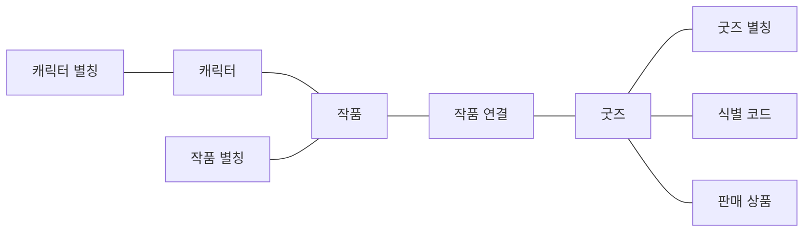
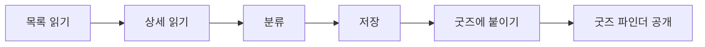
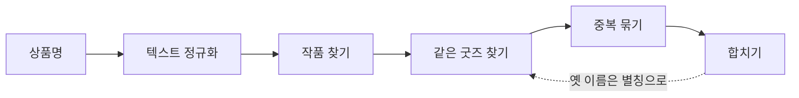
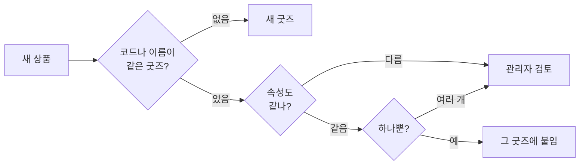
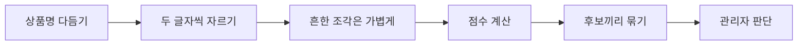
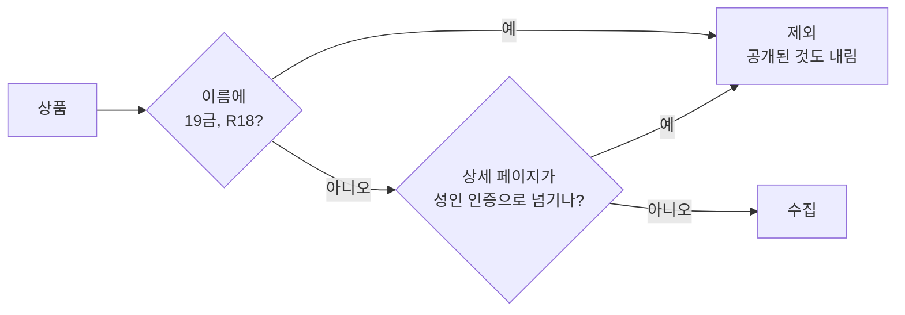

## 개요

[앞서 연 바벨모](../../../10/01/bavelmo-launch/)는 피규어를 3D 장식장에 올려 보여주는 컬렉션이었습니다. 

[프라이머 데모데이](../../../10/07/primer-demo-day/)를 포함해 여러 세미나를 거치면서, 이 방향에 대한 제 확신이 줄어들었습니다. 사용자들이 모바일에서 피규어를 놓는 가상 공간을 정말 즐겨 쓸까? 그리고 활성 사용자를 늘리기 위한 SNS 포맷이 의미가 있을까? 여기에는 확신을 가지지 못했습니다.

지난 서비스는 사용자가 시간을 내고 콘텐츠를 만들어야 쓸 수 있는 플랫폼이었는데, 그 정도의 재미를 제공하는가? 지속 가능한 형태인가?라는 질문에 자신 있게 대답할 수 없었습니다. 그래서 이번에는 사용자에게 바로 이점이 보이는 사이트를 만들고자 했습니다.

여러 구인구직 사이트가 처음에는 공고 데이터를 확보하는 일부터 했던 점을 모델로 봤습니다. 
피규어라는 도메인에 그 흐름을 적용해서 사람들이 먼저 피규어 데이터를 찾는 과정부터 만들어 가며 사용자를 모으기로 생각했습니다.

서비스 주소는 그대로 https://bavelmo.com/입니다.

### 서울 대덕여지도

처음 열리는 화면은 서울 대덕여지도입니다. 
피규어를 취급하는 매장을 서울 지도 위에 모아 둔 화면입니다. 왼쪽 목록에는 매장 이름과 지역이 나오고, 지도의 마커로 매장 수를 보여줍니다. 
IP, 카테고리, 매장 이름으로 찾고 지역으로 한 번 더 좁힐 수 있습니다. 고른 매장은 방문 동선에 담아 공유할 수 있어서 간접 홍보를 노립니다.

### 굿즈 파인더

굿즈 파인더가 지금 메인이고, 여러 상품과 가격을 고르는 화면입니다. 
작품명, 캐릭터, 제조사로 검색하고, 작품 IP와 제조사, 쇼핑몰, 상품 분류, 가격대로 목록을 추릴 수 있습니다. 카드에는 가격, 판매 매장, 그 정보를 마지막으로 확인한 시각이 같이 붙어 있습니다. 
원하는 상품을 숍마다 들어가 가격을 대조하던 일을 이 화면에서 해결하는 게 목적입니다.

## 데이터베이스 구조
굿즈 데이터를 수집 후 자동적으로 IP 매칭되는 그림을 원했고, 브랜드, 제조사 등을 분리하는 구조로 구상하고 구현해보니 사전에 생각해둔 구조보다 꽤 복잡해졌습니다.
굿즈 중심으로 데이터 구조를 파악해봅시다.

<!-- 1차 자료 정리: bavelmo backend 마이그레이션 최종 스키마 기준 -->

### IP와 굿즈 구조

메인 데이터인 굿즈 데이터 구조는 다음처럼 표현할 수 있습니다.

### 목적
위와 같은 구조를 한 이유는 다음과 같은데 컬럼이 다소 생략돼서 이유에서 이를 언급하겠습니다.

#### 1. 굿즈와 판매 상품 분리

같은 굿즈라도 쇼핑몰마다 상품명과 가격이 다릅니다. 그래서 이름과 제조사는 굿즈에 한 번만 적고, 링크와 가격은 쇼핑몰마다 판매 상품에 따로 저장했습니다. 가격 비교는 이 분리 덕분에 가능합니다.

판매 상품이 반드시 굿즈에 연결되어 있지는 않습니다. 어떤 굿즈인지 확실하지 않으면 붙이지 않고 검토 대기로 두기 때문입니다. 수집 후 내부 알고리즘을 통과하지 못한 상품은 이렇게 검토로 빠집니다.

#### 2. 작품(IP) 쪽

굿즈 하나에 작품을 여러 개 붙일 수 있게 한 건 "원신x명조 콜라보" 같은 콜라보 상품 때문입니다. 
작품 하나에는 별칭이 여러 개 있을 수 있지만, 별칭 하나는 작품 하나에만 연결됩니다.

캐릭터는 작품에 소속시켰습니다. "나히다 넨도로이드"처럼 상품명에 작품명 없이 캐릭터만 있는 경우가 많아서, 캐릭터로 소속 작품을 알아내야 했습니다. 다만 캐릭터 이름이 있다고 바로 그 작품으로 붙이지는 않고, 내부 조건을 통과해야 붙입니다.

#### 3. 중복 제거

작품 별칭과 캐릭터 별칭은 한 대상의 다른 이름을 모아 두는 자리로 여러 개를 하나로 묶기 위해 썼습니다. 굿즈 별칭도 크게 보면 같지만 로직이 좀 더 추가됩니다.
여러 사이트 데이터를 수집하니, 수집 중에 같은 상품이 굿즈로 두 번 생겼을 경우 이를 하나로 합치는 작업이 있는데 이때 사라지는 이름이 후에 중복 체크를 위해 저장되는 곳이 굿즈 별칭입니다.

별칭에 넣는 값은 굿즈 번호와 이름입니다. 
- 번호는 어느 굿즈인지 가리킴
- 이름은 그 굿즈의 다른 표기 

두 굿즈를 합치면 연결된 판매 상품은 남는 굿즈로 옮깁니다. 굿즈 별칭에 남은 값은 다음 수집에서 비슷한 상품명이 그 굿즈에 다시 붙도록 해줍니다.
 ※ 통상판과 디럭스판처럼 같은 별칭이 굿즈 여러 개에 있는 경우 검토로 이동

## 수집 시스템

### 전체 흐름
정해진 시간에 등록된 쇼핑몰에서 데이터를 사이트에 악영향 주지 않는 선에서 천천히 수집합니다.

| 단계 | 하는 일 | 비고 |
|---|---|---|
| 1. 목록 읽기 | 신상품, 예약 상품 목록에서 상품 링크와 가격을 수집 | 성인물, 서적, DVD처럼 안 다루는 상품은 여기서 제외(로그인 이동과 텍스트 기반 탐지) |
| 2. 상세 읽기 | 상품 페이지에서 이름, 이미지, 제조사, 식별 코드를 가져옴 | 이미 본 상품은 건너뛰고 가격만 갱신 |
| 3. 분류 | 상품명에서 작품, 캐릭터, 제조사, 스케일을 찾아 붙임| |
| 4. 저장 | 판매 상품을 새로 넣거나 갱신 | 확인한 시각도 같이 저장 |
| 5. 굿즈에 붙이기 | 같은 굿즈가 확실할 때만 병합 | 조건 미달 시 관리자 검토 |
| 6. 공개 | 굿즈에 붙은 상품이 굿즈 파인더에 가격 비교로 표시 |

쇼핑몰에 부담을 주지 않도록 요청 사이에 몇 초씩 쉬고 robots.txt를 따르며 사이트로부터 IP 차단을 당하면 그 쇼핑몰은 바로 멈춥니다.

## 별칭, 중복 시스템

### 전체 흐름
상품 수집하거나 관리자단에서 중복에 대해서는 크게 아래 시스템으로 접근한다고 볼 수 있습니다.

### 상품명 다듬기 (텍스트 정규화)

쇼핑몰은 같은 상품에도 발매일, 예약 문구, 결제 방식, 안내문을 제각각 붙이기에 이걸 걷어내야 같은 상품끼리 이름 비교가 가능합니다.

예를 들어 다음과 같이 같은 굿즈에 대해서 세 쇼핑몰의 상품명입니다.

| 쇼핑몰 상품명 | 다듬은 결과 |
|---|---|
| [26.05발매][예약특가] 프리렌 피규어 (1/1수주예약마감) | 프리렌 피규어 |
| [26.7발매][예약특가] [수량한정] 프리렌 피규어 (3/17 수주마감) | 프리렌 피규어 |
| [예약,26년12월, 27년1월 출고예정] 프리렌 피규어 | 프리렌 피규어 |

발매일과 예약 문구가 든 대괄호, 수주 마감 괄호를 지웁니다. 
"(1/1수주예약마감)"의 1/1은 날짜라서 스케일로 읽지 않습니다. 반대로 "프리렌 1/7 피규어"의 1/7 같은 정해진 스케일 값은 남깁니다.

결제 방식만 다른 상품은 같은 이름이 되고 에디션이 다른 상품은 다른 이름으로 남습니다.
아래와 같이 상품 A, B를 두고 비교하면 아래와 같이 결과가 나옵니다.

| 상품명 A | 상품명 B | 결과 |
|---|---|---|
| 코토부키야 GP022 제로붉은나비리메이크 오시웍스 아마쿠라미오 & 아마쿠라마유 ■ 예약금결제(20000원) | 같은 이름 ■ 전액결제 | 같은 이름 (결제 문구만 다름) |
| [예약판매][총판] 통상판 승리의여신니케 레이블 VKEND 8349 예약금 | [예약판매][총판][디럭스판] 승리의여신니케 레이블 VKEND 8349 전액결제 | 다른 이름 (통상판과 디럭스판) |
| 알터 미쿠 (제조사 알터) | 미쿠 | 같은 이름 (앞에 붙은 제조사만 지움) |
| 알터에고 미쿠 (제조사 알터) | 미쿠 | 다른 이름 ("알터에고"는 제조사가 아님) |

### 작품과 캐릭터 찾기
다음 순서를 거치면서 피규어 데이터에 중복되는 값이나 캐릭터가 있는지 찾습니다.

| 순서 | 규칙 | 예시 |
|---|---|---|
| 1 | 다듬은 상품명에서 작품명, 작품 별칭, 캐릭터명을 찾습니다 | |
| 2 | 두 글자 이름은 단어 맨 앞에 있을 때만 인정합니다 | "건담컨버지"는 건담, "스타명조"는 명조 아님 |
| 3 | 더 긴 작품명 안에 들어 있는 짧은 이름은 버립니다 | "기동전사 건담 수성의 마녀"에서 "건담"은 버림 |
| 4 | 겹치지 않으면 작품을 여러 개 붙입니다 | "원신x명조 콜라보"는 원신, 명조 |
| 5 | 한 작품에만 있는 캐릭터면 그 작품을 붙입니다 | "나히다 넨도로이드"는 "나히다"로 원신 |
| 6 | 하나도 못 찾으면 오타를 감안해 비슷한 작품을 제안만 합니다 | "귀멸의 칼냘 키링"은 귀멸의 칼날 제안 |

캐릭터 이름이 세 글자보다 짧으면 사전에 넣지 않습니다. 짧은 이름은 엉뚱한 상품명에 걸리기 쉬워서 버그 발생률이 높아지더군요.

### 같은 굿즈 찾기 (수집할 때)

| 확인 | 내용 |
|---|---|
| 같은 상품인가 | 식별 코드가 같거나, 별칭 또는 다듬은 이름이 같아야 합니다 |
| 속성이 맞는가 | 제조사, 스케일, 에디션, 색상, 판매 단위가 서로 달라선 안 됩니다 |
| 이름만 같을 때 | 제조사, 분류, 판매 단위, 에디션이 모두 확인돼야 붙입니다. 이름만 같아서는 붙이지 않습니다 |

### 중복 묶기 (관리자 검토)

수집할 때 놓친 중복은 이미 만들어진 굿즈끼리 비교해서 찾습니다. 이 비교는 관리자 화면에서만 돌아가며 수집 중에는 앞의 "같은 굿즈 찾기" 규칙만 적용합니다.

수집에서는 확실한 경우만 묶는다면 여기서는 관리자단에서 하므로 여러 가지 조건들을 통해 묶어줘서 보여줄 수 있도록 합니다.

예를 들어 두 쇼핑몰의 같은 프라모델입니다.

| | 굿즈 A | 굿즈 B |
|---|---|---|
| 원래 이름 | [예약판매][총판] ARKFRAME A-07 아누비스 프라모델 스네일쉘 | 스네일쉘 ARKFRAME A-07 아누비스(프라모델) |
| 다듬은 이름 | arkframe a 07 아누비스 | arkframe a 07 아누비스 |
| 두 글자 조각 | ar, rk, kf, fr, ra, am, me, ea, a0, 07, 7아, 아누, 누비, 비스 | ar, rk, kf, fr, ra, am, me, ea, a0, 07, 7아, 아누, 누비, 비스 |
| 점수 | 1.0 (조각이 모두 같음), 후보 | |

단어 순서와 제조사 위치가 달라도 판매 문구와 제조사, "프라모델"과 같은 범용적인 수식어를 제외한 뒤 두 글자씩 자르면 남는 조각이 같아집니다. 
남은 조각으로 비교하면 같은지 체크할 수 있습니다. 

이 예시에서는 14개 조각이 하나도 빠짐없이 같습니다.

#### 왜 두 글자인가

쇼핑몰마다 띄어쓰기가 제각각입니다. 
같은 상품이 "승리의여신니케"와 "승리의 여신 니케"로 올라오면 단어 단위로는 하나도 겹치지 않게 됩니다. 그래서 공백을 모두 지운 뒤 한 글자씩 이동하며 두 글자로 잘라 냅니다.

아래 테이블을 보시면 이유를 알 수 있죠.

| 자르는 단위 | "아누비스"를 자른 결과 | 문제 |
|---|---|---|
| 단어 | 아누비스 | 붙여 쓰거나 띄어 쓰면 통째로 어긋남 |
| 한 글자 | 아, 누, 비, 스 | 글자 순서를 잃음. "스비누아"도 같은 조각이 됨 |
| 두 글자 | 아누, 누비, 비스 | 띄어쓰기와 무관하면서 글자 순서도 일부 지킴 |
| 세 글자 | 아누비, 누비스 | 한 글자만 달라도 사라지는 조각이 많고, "명조", "니케" 같은 두 글자 이름은 그 이름만의 조각이 생기지 않음 |

조각은 집합으로 다뤄 같은 조각이 두 번 나와도 한 번만 세고 단어 순서가 바뀌어도 단어 경계의 조각만 영향을 받습니다.

#### 점수 계산

조각마다 무게가 다릅니다. "붕괴 스타레일 타이니 캣 아크릴 키링"처럼 여러 상품에 나오는 조각은 가볍고, "케리드라"처럼 드문 조각은 무겁습니다. 그래서 시리즈 이름만 겹치는 상품은 점수가 낮게 나옵니다. 이렇게 드문 단어에 무게를 더 주는 방식을 IDF(Inverse Document Frequency, 적게 등장할수록 가중치를 높이는 방식)라고 합니다.

조각 $p$의 무게는 다음과 같습니다. 
$N$은 전체 굿즈 수, $n_p$는 조각 $p$가 들어 있는 굿즈 수입니다.

$$w(p) = \ln\frac{N+1}{n_p}$$

$n_p$는 관리자가 중복 목록을 열 때마다 구합니다. 전체 굿즈의 조각을 "조각 → 굿즈 목록" Map으로 먼저 모으고, 그 목록 길이를 그대로 씁니다. 
Elasticsearch의 역인덱스(단어에서 그 단어가 든 문서 목록을 찾는 구조)를 요청마다 메모리에 만드는 셈입니다. 아직은 가볍게 가져가고 싶어서 Elasticsearch까지 들이지는 않았습니다.

두 굿즈의 점수는 무게를 반영한 Dice 유사도(두 집합이 얼마나 겹치는지를 0에서 1 사이로 나타내는 지표)입니다. 겹친 조각의 무게를 두 배 한 값을 두 굿즈 조각 무게의 합으로 나눕니다.

두 지표의 출처는 다음과 같습니다.
- Dice 유사도: [Dice(1945), "Measures of the Amount of Ecologic Association Between Species"](https://doi.org/10.2307/1932409). 원래는 두 생물 종이 같은 지역에 함께 나타나는 정도를 재려고 제안한 지표
- IDF: [Spärck Jones(1972), "A statistical interpretation of term specificity and its application in retrieval"](https://doi.org/10.1108/eb026526). 여러 문서에 흔히 나오는 검색어일수록 덜 중요하게 보자는 가중치

아래 식은 특정 논문의 식을 그대로 가져온 것이 아닙니다.  
원래 Dice 식에서 조각 개수를 세던 자리에 IDF 무게를 넣어 결합한 식입니다.

$$\text{score}(A, B) = \frac{2\sum_{p \in A \cap B} w(p)}{\sum_{p \in A} w(p) + \sum_{p \in B} w(p)}$$

| 항목 | 내용 |
|---|---|
| 1점 | 두 굿즈의 조각이 모두 같음 |
| 0점 | 겹치는 조각이 없음 |
| 흔한 조각이 겹칠 때 | 분자에 더해지는 값이 작아 점수가 조금 오름 |
| 드문 조각이 겹칠 때 | 분자에 더해지는 값이 커서 점수가 크게 오름 |

굿즈 300개를 넘게 공유하는 조각(제조사 이름, "넨도로이드" 등)은 후보를 좁히는 단계에서는 쓰지 않지만 점수에는 그대로 들어갑니다.

점수가 기준을 넘어도 제조사, 스케일, 에디션 같은 속성이 서로 다르거나, 관리자가 이미 다른 상품이라고 표시한 쌍이면 후보에서 뺍니다.

| 굿즈 A | 굿즈 B | 결과 |
|---|---|---|
| 알터 우마무스메 프리티 더비 아그네스 타키온 1/7 완성품 피규어 | [알터][우마무스메 프리티 더비] 아그네스 타키온 1/7 | 후보 |
| 하비사쿠라 승리의 여신 니케 아니스 디럭스판 | 하비사쿠라 승리의 여신 니케 아니스 통상판 | 제외 (에디션이 다름) |
| 명조 모니에 1/6 스케일 | 명조 모니에 1/7 스케일 | 제외 (스케일이 다름) |
| 블루아카이브 노아 파자마 (코토부키야) | 블루아카이브 노아 파자마 (굿스마일컴퍼니) | 제외 (제조사가 다름) |
| 같은 쇼핑몰: 베르세르크 쿠리파크 GECCO 잔금결제 | 같은 쇼핑몰: 베르세르크 쿠리파크 GECCO 전액결제 | 후보 |
| 같은 쇼핑몰: 붕괴 스타레일 타이니 캣 아크릴 키링 케리드라 | 같은 쇼핑몰: 같은 이름 에버나이트 | 제외 (같은 시리즈의 다른 캐릭터) |

후보 기준은 두 굿즈가 같은 쇼핑몰의 상품을 공유하는지에 따라 다릅니다.

| 비교 대상 | 후보 기준 | 이유 |
|---|---|---|
| 다른 쇼핑몰끼리 | 0.6점 이상 | 쇼핑몰마다 붙이는 문구가 달라서 이름이 꽤 달라도 같은 상품일 수 있음 |
| 같은 쇼핑몰끼리 | 0.95점 이상 | 이름이 비슷하면 대개 같은 시리즈의 다른 상품이라, 잔금결제와 전액결제처럼 거의 같은 이름만 짝지음 |

또 후보는 이어지는 것끼리 묶입니다. 그래서 1과 2, 2와 3이 후보면 1, 2, 3이 한 묶음입니다. 

관리자가 합치면 판매 상품과 코드가 남는 굿즈로 옮겨지고 없어지는 굿즈의 이름은 별칭으로 남습니다. 다른 상품이라고 표시하면 그 쌍은 다시 후보에 올라오지 않습니다.

## 필터링

성인물은 두 번 거릅니다.

1. 상품명에 표시가 있어서 텍스트로 체크 가능한 경우
2. 상세 페이지에서 로그인으로의 이동이 존재하는지

