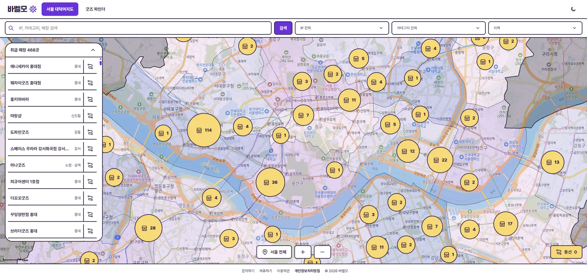
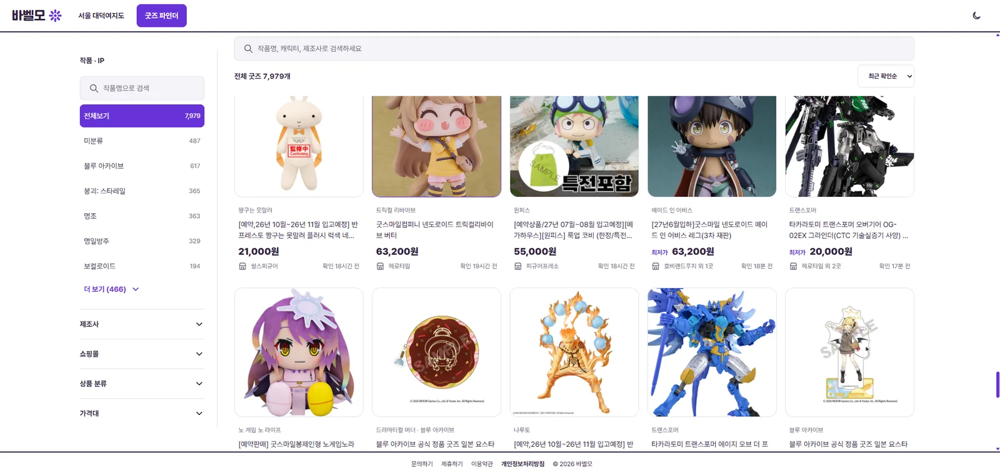

## 개요

[앞서 연 바벨모](../../../10/01/bavelmo-launch/)는 피규어를 3D 장식장에 올려 보여주는 컬렉션이었습니다. 

[프라이머 데모데이](../../../10/07/primer-demo-day/)를 포함해 여러 세미나를 거치면서, 이 방향에 대한 제 확신이 줄어들었습니다. 사용자들이 모바일에서 피규어를 놓는 가상 공간을 정말 즐겨 쓸까? 그리고 활성 사용자를 늘리기 위한 SNS 포맷이 의미가 있을까? 여기에는 확신을 가지지 못했습니다.

지난 서비스는 사용자가 시간을 내고 콘텐츠를 만들어야 쓸 수 있는 플랫폼이었는데, 그 정도의 재미를 제공하는가?, 지속 가능한 형태인가? 이라는 질문에 자신있게 대답 할 수 없었습니다. 그래서 이번에는 사용자에게 바로 이점이 보이는 사이트를 만들고자 했습니다.

여러 구인구직 사이트가 처음에는 공고 데이터를 확보하는 일부터 했던 점을 모델로 봤습니다. 
피규어라는 도메인에 그 흐름을 적용해서 사람들이 먼저 피규어 데이터를 찾는 과정부터 만들어 가며 사용자를 모으기로 생각했습니다.

서비스 주소는 그대로 https://bavelmo.com/입니다.

### 서울 대덕여지도

처음 열리는 화면은 서울 대덕여지도입니다. 
피규어를 취급하는 매장을 서울 지도 위에 모아 둔 화면입니다. 왼쪽 목록에는 매장 이름과 지역이 나오고, 지도의 마커로 매장 수를 보여줍니다. 
IP, 카테고리, 매장 이름으로 찾고 지역으로 한 번 더 좁힐 수 있습니다. 고른 매장은 방문 동선에 담아 공유할 수 있어서 간접 홍보를 노립니다.

### 굿즈 파인더

굿즈 파인더가 지금 메인이고, 여러 상품과 가격을 고르는 화면입니다. 
작품명, 캐릭터, 제조사로 검색하고, 작품 IP와 제조사, 쇼핑몰, 상품 분류, 가격대로 목록을 추릴 수 있습니다. 카드에는 가격, 판매 매장, 그 정보를 마지막으로 확인한 시각이 같이 붙어 있습니다. 
원하는 상품을 샵마다 들어가 가격을 대조하던 일을 이 화면에서 해결하는 게 목적입니다.

## 데이터베이스 구조
현재 DB 구조는 꽤나 복잡한데, IP와 IP 별칭, 제조사, 브랜드, 피규어 이름이 섞이다 보니 이렇게 되었네요.
피규어 중심으로 데이터 구조를 파악해봅시다.

## 수집 시스템
특히 이게 개요랑 이어지는 듯합니다.

## 별칭, 중복 시스템
핵심 시스템

## 필터링
성인물..