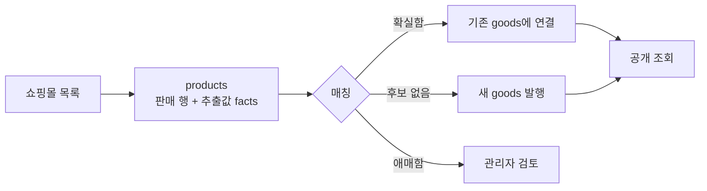
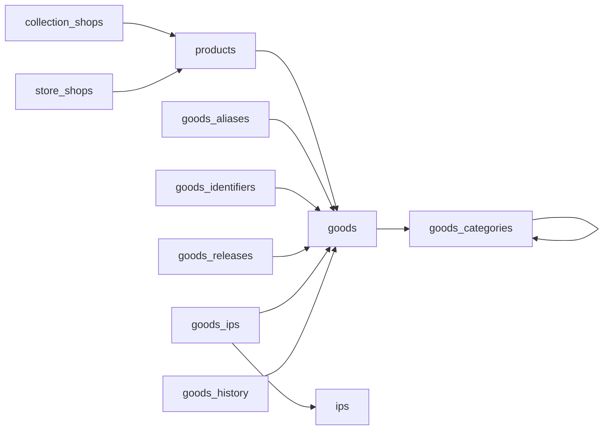

## 개요

[지난 글](../../../10/01/bavelmo-launch/)에서 Bavelmo를 피규어 전용 컬렉터 SNS로 소개했습니다.<br/>
지금 Bavelmo는 방향을 바꿔 원하는 굿즈를 어디서 살 수 있는지 찾아 주는 굿즈 파인더가 되었습니다.

<!-- TODO: SNS에서 굿즈 파인더로 방향을 바꾼 이유 -->

서비스는 두 축으로 움직입니다.

1. 매장 찾기: 서울의 굿즈 매장을 지도와 동선으로 보여 줍니다.
2. 쇼핑몰 상품 모아 보기: 오프라인 매장이 없는 온라인 쇼핑몰의 상품도 같은 카드로 보여 줍니다.

두 번째 축을 만들면서 백엔드에서 가장 오래 붙잡은 질문은 하나였습니다.

> 같은 피규어가 쇼핑몰 열 곳에 열 가지 이름으로 올라올 때, 이를 어떻게 굿즈 하나로 유지할 것인가?

"넨도로이드 프리렌", "[예약] 굿스마일 넨도 프리렌 장송의 프리렌", "Nendoroid Frieren"은 모두 같은 상품입니다. 반대로 이름이 거의 같아도 색상이나 스케일이 다르면 다른 상품입니다.<br/>
이 글은 이 문제를 스키마, 제약, 트랜잭션으로 어떻게 풀었는지 정리합니다.

## 시연

<!-- TODO: 구매자 화면 캡처 (목록, 필터, 상세 팝업) -->

구매자 화면에서는 굿즈마다 카드 하나를 보여 줍니다.

- IP, 상품 분류, 제조사, 쇼핑몰, 가격대로 거를 수 있습니다. 같은 그룹 안은 OR, 그룹 사이는 AND로 묶입니다.
- 목록은 24개씩 무한 스크롤로 이어지고, 검색 조건과 페이지는 URL로 복원됩니다.
- 상세 팝업에는 판매처별 가격과 링크가 나오고, 가장 싼 곳에 최저가 표시가 붙습니다.

상세 팝업의 "판매처 여러 곳"이 이 글의 주제입니다.<br/>
쇼핑몰 세 곳의 판매 글이 카드 하나로 보인다는 것은, 뒤에서 세 판매 글이 같은 굿즈라고 판정되어 묶였다는 뜻입니다.

## 데이터 흐름

수집 방법은 이 글에서 다루지 않고 흐름만 짚습니다.



판매 행 하나는 `review_state`로 상태를 가지며, 값은 `CHECK`로 네 가지만 허용합니다.

| 상태 | 의미 |
|---|---|
| `pending` | 근거가 부족해 검토를 기다리는 행 |
| `linked` | 굿즈에 연결되어 공개되는 행 |
| `conflict` | 후보 굿즈와 속성이 충돌해 사람이 봐야 하는 행 |
| `excluded` | 공개에서 뺀 행(결제용 가상 상품, 성인 상품 등) |

공개 API는 `linked` 행만 읽습니다. 애매한 데이터가 구매자 화면에 새어 나가지 않도록 상태 하나로 경계를 그었습니다.

## 스키마 설계

### 판매 행과 기준 상품의 분리

가장 중요한 결정은 `products`와 `goods`를 나눈 것입니다.

- `products`는 판매 행입니다. 어느 쇼핑몰이 어떤 URL에서 얼마에 파는지를 담습니다.
- `goods`는 기준 상품입니다. 이 상품이 무엇인지(이름, 제조사, 분류, 속성)를 담습니다.

판매 행 N개가 굿즈 1개를 가리키는 구조이므로, 중복 처리는 결국 "이 판매 행의 `goods_id`를 무엇으로 채울 것인가"라는 문제로 바뀝니다.



### 별도 테이블과 JSONB를 나눈 기준

굿즈 속성은 몰마다, 상품 종류마다 항목이 다릅니다. 피규어에는 스케일이 있고 의류에는 사이즈가 있습니다.<br/>
그래서 기준을 하나로 정했습니다. 고유성 보장이나 외래 키(FK)가 필요한 값만 별도 테이블로 빼고, 나머지는 JSONB에 둡니다.

| 값 | 위치 | 이유 |
|---|---|---|
| 별칭, 식별 코드, 출시 차수, IP, 이력 | 별도 테이블 | 유일성 제약이나 FK가 필요하고 수명이 굿즈 본체와 다르다 |
| 스케일, 재질, 크기 같은 세부 속성 | `goods.data` JSONB | 종류마다 항목이 다르고 개별 고유성이 필요 없다 |
| 쇼핑몰에서 추출한 원본 값 | `products.facts` JSONB | 몰마다 항목이 다르다 |

### 확장 방식

- 판매처는 `collection_shops` 행 하나이고 `site_key`(www나 m 접두사를 뺀 호스트)가 `UNIQUE`입니다. 판매처가 늘어도 스키마는 바뀌지 않습니다.
- 분류는 `goods_categories`가 자기 자신을 `parent_id`로 참조하는 계층 구조라서 대분류와 소분류를 테이블 하나로 표현합니다.
- 스키마 변경은 마이그레이션 파일로만 하고, 이미 적용된 파일은 고치지 않고 새 파일을 추가합니다. 지금까지 54개가 쌓였습니다.

## 데이터 무결성

무결성 규칙을 "DB가 보장하는 것"과 "애플리케이션이 보장하는 것"으로 나눴습니다.<br/>
원칙은 단순합니다. 경로가 여러 개라서 한 곳이라도 빠뜨리면 깨지는 규칙은 DB에 두고, 판단이 필요한 규칙은 애플리케이션에 둡니다.

### DB가 보장하는 것

| 규칙 | 구현 |
|---|---|
| 판매 행은 매장 쇼핑몰과 수집 쇼핑몰 중 정확히 한 곳에 속한다 | 배타 FK 두 개 + `CHECK ((shop_id IS NULL) <> (collection_shop_id IS NULL))` |
| 같은 판매 행은 한 번만 저장된다 | 부분 유니크 인덱스 `(collection_shop_id, external_id, option_id)` |
| 같은 바코드는 굿즈 하나에만 붙는다 | `UNIQUE (kind, manufacturer, normalized) WHERE kind <> 'unknown'` |
| 제조사 별칭은 같은 종류 안에서 유일하다 | `(vocabulary_id, kind)` 복합 FK + `UNIQUE (kind, alias)` |
| "다른 상품" 판정은 한 쌍당 한 번만 저장된다 | `PRIMARY KEY (left_id, right_id)` + `CHECK (left_id < right_id)` |
| 굿즈를 지워도 이력은 남는다 | 하위 테이블은 `ON DELETE CASCADE`, `goods_history`는 `ON DELETE SET NULL` |
| 사용 중인 분류는 지울 수 없다 | `goods_categories`는 `ON DELETE RESTRICT` |
| 공개 확인 시각은 한 곳에서 갱신된다 | 트리거 `products_touch_goods` |
| 관리자가 지운 표기는 다시 들어오지 않는다 | `goods_name_blocks (kind, name_key)` |

몇 가지는 설명이 필요합니다.

배타 FK는 판매 행의 주인이 두 종류라서 생겼습니다. 관리자가 매장에 직접 등록한 상품은 매장 쇼핑몰(`store_shops`)에, 수집한 상품은 수집 쇼핑몰(`collection_shops`)에 속합니다.<br/>
FK 하나에 종류 컬럼을 두는 다형 참조로도 만들 수 있지만, 그렇게 하면 DB가 참조 대상을 검사할 수 없습니다. FK를 두 개 두고 `CHECK`로 "정확히 하나만 채운다"를 강제하면 참조 무결성과 `ON DELETE CASCADE`를 둘 다 얻을 수 있습니다.

식별 코드 유니크 인덱스에는 `WHERE kind <> 'unknown'` 조건이 붙어 있습니다. 쇼핑몰이 "상품코드"라고 적은 숫자가 바코드인지 자체 관리 번호인지 모르는 경우가 많기 때문입니다.<br/>
정체를 모르는 코드는 저장은 하되 유일성을 강제하지도 않고 매칭 근거로도 쓰지 않습니다. 검증된 코드만 "같은 상품"을 주장할 수 있습니다.

`goods.updated_at`은 구매자 화면의 "최근 확인순" 정렬 기준입니다. 판매 행이 굿즈에 새로 연결될 때 갱신해야 하는데, 연결이 일어나는 경로가 수집, 시드, 관리자 연결, 자동 발행으로 네 곳입니다.<br/>
네 곳의 코드에 각각 갱신문을 넣으면 언젠가 하나를 빠뜨립니다. 그래서 `products`의 `goods_id`나 `review_state`가 바뀔 때 도는 트리거 하나로 모았습니다.

```sql
CREATE TRIGGER products_touch_goods
  AFTER INSERT OR UPDATE OF goods_id, review_state ON products
  FOR EACH ROW EXECUTE FUNCTION touch_linked_goods();
```

트리거 함수는 행이 `linked`로 새로 붙었거나 다른 굿즈로 옮겨졌을 때만 갱신합니다. 같은 판매 행을 다시 수집했을 때는 시각이 바뀌지 않습니다.

`goods_name_blocks`는 삭제를 기억하는 테이블입니다. 관리자가 잘못된 제조사 표기를 지워도, 다음 수집이 같은 표기를 빈 칸에 다시 채우면 삭제는 의미가 없어집니다.<br/>
지운 표기의 비교 키를 남겨 두고 수집과 빈 칸 채우기가 이 키를 건너뛰게 했습니다.

### 애플리케이션이 보장하는 것

- 굿즈 병합은 한 트랜잭션에서 실행하고, 시작할 때 관련 굿즈 행을 `FOR UPDATE`로 잠급니다. 병합 도중에 다른 요청이 같은 굿즈에 판매 행을 붙이지 못합니다.
- 수집 실행은 PostgreSQL advisory lock(테이블 행이 아니라 앱이 정한 숫자 키에 거는 잠금)으로 직렬화해 동시에 두 번 돌지 않습니다.
- 관리자가 고친 칸은 `manual_fields`에 기록해 재수집이 덮어쓰지 않습니다.
- 비교 키는 저장하기 전에 정규화합니다.

마지막 항목이 유니크 제약을 실제로 동작하게 만드는 전제입니다.<br/>
`4580590123456`과 `4580590-123456`이 다른 문자열로 저장되면 유니크 인덱스는 둘을 다른 값으로 보고 통과시킵니다. 그래서 GTIN(상품 바코드 국제 표준, 일본 JAN 코드도 GTIN-13)은 체크디지트를 검증하고 14자리로 맞춘 값을 `normalized`에 저장합니다.

```ts
export function normalizeGtin(value: string): string | null {
  const digits = value.replace(/[\s-]/g, '');
  if (!/^(?:\d{8}|\d{12}|\d{13}|\d{14})$/.test(digits)) return null;
  // 체크디지트 검증 생략
  return digits.padStart(14, '0');
}
```

문자열 비교 키는 유니코드 NFKC 정규화(전각 문자 `ＡＢＣ`를 `ABC`로 바꾸는 식의 호환 문자 통일) 뒤 소문자로 바꾸고 공백과 문장부호를 뺀 값입니다. 별칭, 품번, 제조사 표기가 모두 같은 함수를 거칩니다.

## 별칭 테이블 설계

별칭은 중복 판정의 근거이므로 중복 처리보다 먼저 정리합니다.<br/>
별칭 테이블은 세 종류이고, 테이블마다 유일성 범위를 일부러 다르게 잡았습니다.

| 테이블 | 키 | 유일성 범위 |
|---|---|---|
| `goods_aliases` | `PRIMARY KEY (goods_id, alias)` | 굿즈 안에서만 유일 |
| `goods_vocabulary_aliases` | `UNIQUE (kind, alias)` | 제조사, 브랜드, 라인 종류 안에서 전역 유일 |
| `ip_character_aliases` | `PRIMARY KEY (character_id, alias)` | 캐릭터 안에서만 유일 |

`goods_aliases`가 전역 유일이 아닌 이유는 같은 별칭이 여러 굿즈에 정당하게 붙을 수 있기 때문입니다. "넨도로이드 프리렌"은 일반판과 한정판 모두의 별칭일 수 있습니다.<br/>
DB가 이를 막으면 둘 중 하나는 별칭을 잃습니다. 그래서 DB에서는 허용하고, 매칭 단계에서 후보가 둘 이상 나오면 자동으로 연결하지 않고 검토로 보냅니다.

반대로 제조사 표기는 모호하면 안 됩니다. "굿스마일"이 굿스마일컴퍼니이면서 동시에 다른 회사일 수는 없습니다. 그래서 종류 안에서 전역 유일로 강제했습니다.<br/>
복합 FK `(vocabulary_id, kind)`는 별칭의 종류가 부모 명칭의 종류와 항상 같도록 보장합니다. 제조사 별칭이 브랜드 명칭에 붙는 실수를 DB가 거부합니다.

### IP와 캐릭터로 작품 찾기

상품명에서 작품(IP)을 찾을 때는 IP 이름과 별칭 외에 캐릭터 사전(`ip_characters`)도 씁니다. 상품명에 작품명 없이 캐릭터 이름만 있는 경우가 많기 때문입니다.

- 캐릭터가 맞으면 그 캐릭터의 IP를 붙입니다.
- 같은 캐릭터 이름이 여러 IP에 있으면 IP를 정하지 않습니다.
- 캐릭터 이름은 NFKC 정규화 후 글자와 숫자만 세어 3글자 이상이어야 합니다. 짧은 이름은 다른 단어 속에 우연히 들어 있을 확률이 높습니다.

형태소 분석기나 검색 엔진 없이 규칙으로 비교합니다. 표기를 통일하고(뱃지는 배지로, 피겨는 피규어로), 한글과 영문과 숫자의 경계에서 단어를 나눕니다. 두 글자 이하 이름은 단어 시작에서만 맞추고, 더 긴 이름이 같은 자리를 덮으면 짧은 이름의 IP는 버립니다. "기동전사 건담 수성의 마녀"가 맞으면 그 안의 "건담"은 무시하는 식입니다.<br/>
비슷하지만 같지 않은 이름은 관리자에게 제안만 하고 자동으로 붙이지 않습니다.

## 중복 해결 3단계

중복은 세 층에서 다르게 막습니다. 층마다 누가 막는지가 다릅니다.

| 단계 | 질문 | 막는 주체 |
|---|---|---|
| 1 | 같은 판매 행인가? | DB 유니크 인덱스 |
| 2 | 이 판매 행은 어느 굿즈인가? | DB 유니크 제약 + 매칭 규칙 |
| 3 | 이미 생긴 굿즈끼리 같은 상품인가? | 애플리케이션 + 관리자 확인 |

### 1단계: 같은 판매 행

같은 쇼핑몰의 같은 상품 옵션은 한 행입니다. `(collection_shop_id, external_id, option_id)`와 `(collection_shop_id, url, option_id)` 부분 유니크 인덱스가 이를 보장합니다.<br/>
재수집은 새 행을 만들지 않고 기존 행을 갱신합니다. 수집에 실패하거나 목록에서 사라져도 기존 값을 지우지 않습니다.

### 2단계: 판매 행을 굿즈에 연결

새 판매 행이 들어오면 연결할 굿즈 후보를 찾습니다. 근거는 강한 순서로 네 가지입니다.

1. 식별 코드 일치: 검증된 GTIN, 또는 같은 제조사의 품번
2. 승인 별칭 일치
3. 본체 이름 일치: 판매 문구(예약, 한정, 특전 등)를 뺀 이름이 같음
4. 이름 포함: 한쪽 이름이 다른 쪽 이름 안에 들어 있음(검토로만 보냄)

자동 연결 조건은 의도적으로 엄격합니다.

- 식별 코드가 일치하거나,
- 별칭이나 본체 이름이 일치하면서 제조사, 분류, 판매 단위, 판본 근거가 모두 있어야 하고,
- 어느 경우든 속성 충돌이 없어야 합니다.

충돌을 판정하는 항목은 분류, 제조사, 브랜드, 라인, 판본, 색상, 구성, 판매 단위, 스케일, 등급, 재질, 크기, 의류 사이즈, 도안, 캐릭터, 식별 코드입니다. 이 중 하나라도 양쪽 값이 다르면 다른 상품으로 봅니다.<br/>
여기서 중요한 규칙은 "빈 값은 다른 값이 아니다"입니다. 굿즈의 제조사 칸이 비어 있으면 아직 모르는 것이지 다른 제조사라는 뜻이 아닙니다. 빈 칸을 충돌로 보면 정보가 적은 굿즈일수록 중복이 늘어납니다.

같은 사양의 재판은 별도 굿즈가 아니라 같은 굿즈 아래 출시 차수(`goods_releases`)로 나눕니다. 랜덤 단품, BOX, 세트는 판매 단위가 다르므로 별도 굿즈입니다.

후보를 찾을 때 카탈로그 전체를 훑지는 않습니다. 이름, 코드, 별칭, 이름의 3글자 조각을 키로 하는 인덱스로 후보를 좁힌 뒤 위 규칙을 적용합니다.

### 3단계: 이미 생긴 굿즈끼리의 중복

2단계가 보수적이라 같은 상품이 굿즈 두 개로 발행되는 경우가 생깁니다. 이 경우는 관리자 화면에서 중복 후보로 찾아 병합합니다.

후보 점수는 이렇게 계산합니다.

1. 이름에서 판매 문구, 제조사와 브랜드 표기, 채움 단어(완성품, 피규어, 정품 등)를 뺍니다.
2. 공백을 없앤 뒤 2글자 조각 집합으로 나눕니다. 띄어쓰기와 어순이 달라도 점수가 크게 변하지 않습니다.
3. 조각마다 IDF 가중치(많은 굿즈가 공유하는 조각일수록 낮은 점수)를 줍니다. "블루 아카이브 공식 정품 굿즈" 같은 공통 접두어는 가볍고, 캐릭터나 품목 단어가 점수를 결정합니다.
4. 가중 Dice 계수로 비교합니다.

$$
\text{score}(A, B) = \frac{2 \sum_{p \in A \cap B} w_p}{\sum_{p \in A} w_p + \sum_{p \in B} w_p}, \quad w_p = \log\frac{N + 1}{df_p}
$$

기준은 0.6이고, 같은 쇼핑몰의 굿즈끼리는 0.95입니다. 한 쇼핑몰 안에서 이름이 비슷한 상품은 대개 같은 시리즈의 다른 캐릭터이기 때문입니다. 같은 몰 안의 중복은 예약금 상품과 잔금 상품처럼 이름이 거의 같은 경우만 잡습니다.<br/>
점수가 높아도 2단계와 같은 속성 충돌이 있으면 후보에서 뺍니다.

후보 쌍은 union-find(서로소 집합 자료구조)로 묶어 그룹 단위로 보여 줍니다. A와 B, B와 C가 후보이면 A, B, C를 한 그룹으로 비교합니다.

관리자가 "다른 상품"으로 확인한 쌍은 `goods_distinct_pairs`에 저장해 다시 후보로 올리지 않습니다. 같은 쌍을 두 방향으로 저장하지 않도록 `CHECK (left_id < right_id)`를 걸었습니다.

### 병합 규칙

병합은 한 트랜잭션에서 다음 순서로 실행합니다.

1. 남길 굿즈와 지울 굿즈를 `FOR UPDATE`로 잠급니다.
2. 판매 행, 출시 차수, 식별 코드는 남길 굿즈로 옮깁니다.
3. 별칭, IP, 숨긴 사진은 남길 굿즈에 복사합니다.
4. 남길 굿즈의 값이 우선이고, 빈 제조사, 브랜드, 라인, 분류, 속성만 지울 굿즈의 값으로 채웁니다.
5. 이력을 옮기고 지울 굿즈를 삭제한 뒤 "굿즈 병합" 이력을 남깁니다.

식별 코드를 복사하지 않고 옮기는 이유는 유니크 인덱스 때문입니다. 같은 GTIN이 두 굿즈에 동시에 있을 수 없으므로, 옮기지 않으면 제약 위반이 납니다. DB 제약이 병합 순서까지 정해 준 셈입니다.

## 한계와 다음 개선

설계하면서 알고도 남겨 둔 지점이 있습니다.

1. 제조사, 브랜드, 라인이 FK 없이 텍스트로 복사되어 있습니다. 관리자 메뉴에서 이름을 바꾸면 같은 표기를 모두 따라 바꾸지만, 굿즈 편집에서 사전에 없는 이름을 저장하는 것은 DB가 막지 못합니다.
2. `goods_identifiers.release_key`가 `goods_releases`를 참조하지 않는 일반 텍스트입니다. `goods_releases`에 `UNIQUE (id, goods_id)`를 만들어 복합 FK를 걸 준비는 해 뒀지만, 실제 FK는 아직 없습니다.
3. `product_ips`가 `goods_ips`와 역할이 겹칩니다. 공개 조회는 `goods_ips`만 쓰고, `product_ips`는 관리자가 직접 등록한 상품에만 남아 있습니다.
4. 중복 후보는 요청할 때마다 카탈로그 전체로 계산합니다. 관리자만 쓰는 화면이라 지금은 충분하지만, 카탈로그가 커지면 후보를 미리 계산해 두는 방식으로 바꿔야 합니다.

<!-- TODO: 마무리 -->
