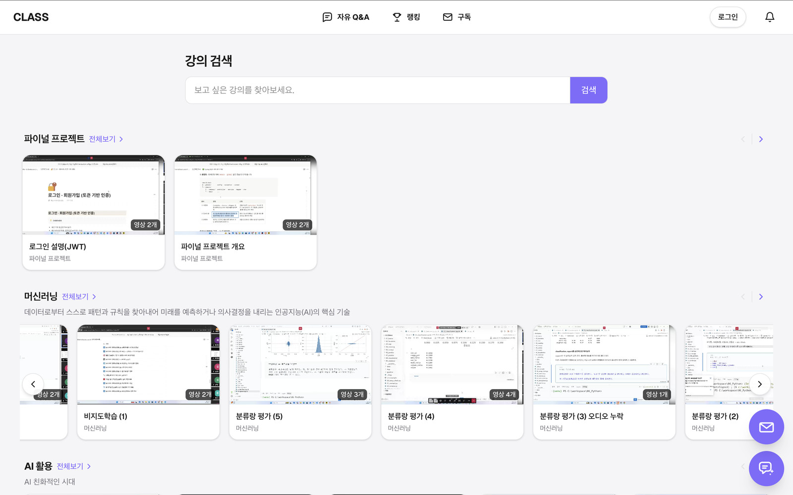
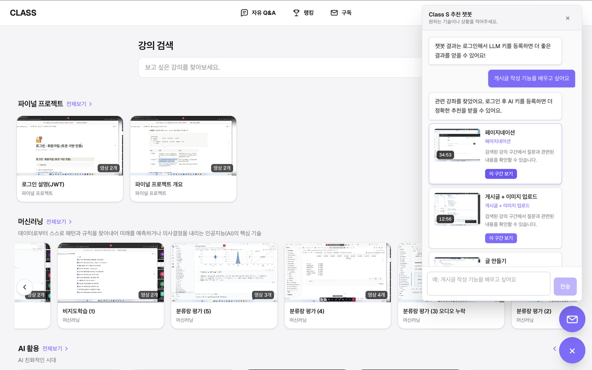
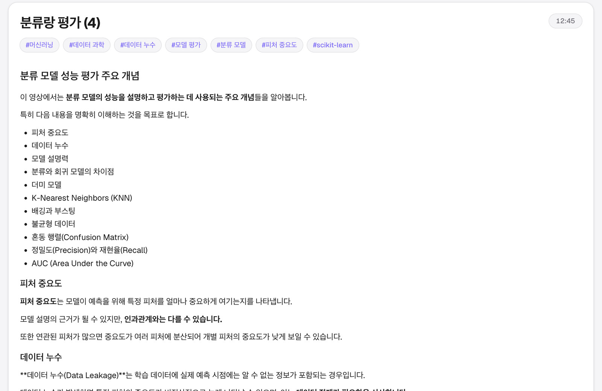
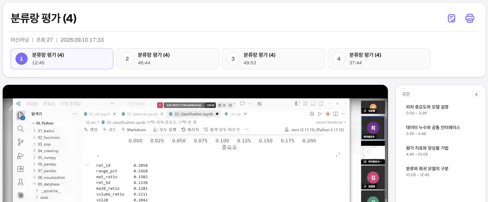
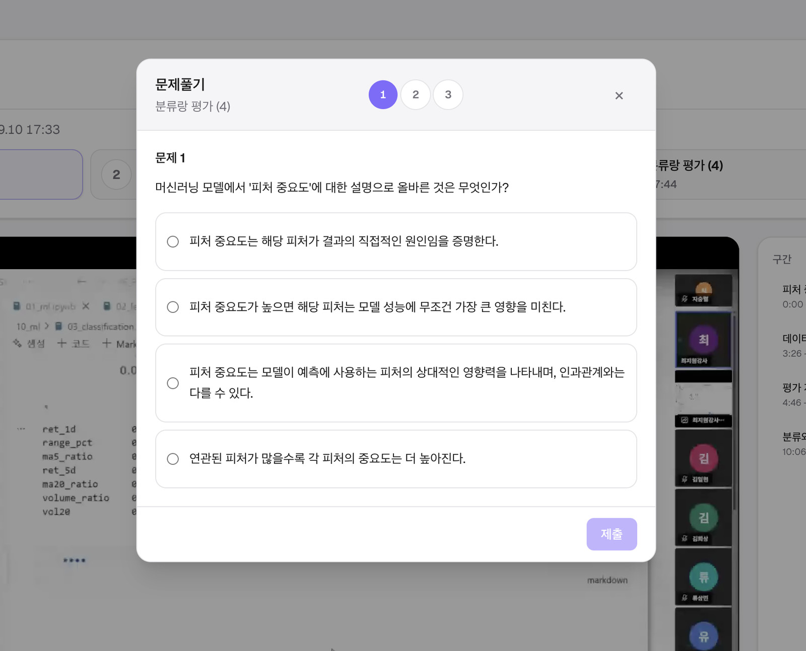

## Class 프로젝트
[class 프로젝트 시리즈](/series/class-s-project/)는 OTT 업계에 어필할 만한 사이드 프로젝트를 만들겠다는 포부를 가지고 진행했던 서비스입니다. 

실제 사용자 유저층을 받을 수 있고 리소스도 쉽게 습득이 가능했기에 6월부터 9월까지 진행했던 프로젝트죠. 
이제 11월 20일 기준으로 부트캠프가 종료되었기 때문에 해당 프로젝트도 닫으려고 합니다.

이 프로젝트를 진행하면서 경험해 본 바는 아래와 같습니다. 
블로그 시리즈에 묶인 것처럼 인코딩 서버를 서버리스로 띄우고 여기서 비동기로 영상 인코딩 작업을 한 뒤 s3에랑 cdn에 올려 비용을 최적화해 보기도 하고 이 주제로 파이콘에서 튜토리얼 진행하고 고등학교에서도 진행했죠.

AI 관련해서 맛보기를 잠깐 해 봤었는데 이것도 좋았습니다.

영상을 통해 생성된 청크 기반으로 RAG 데이터를 생성하는 것도 해 보고 Postgres에 임베딩해서 한국어 의미 기반으로 검색 + FTS도 같이 하는 하이브리드도 만들어 봤죠.

청크 기반으로 타임라인도 만들고 설명문도 만들고, 문제도 만들고

## 개선점
영상 인코딩 관련으로 "로컬 테스트"했다는 점과 "부하 테스트"를 생략한 점이 아쉽네요. 
아무래도 로컬 테스트라는 점 때문에 서버 PC의 스펙이 어떻게 되었을 때 속도가 얼마나 나오고를 
프로젝트의 특성상 아무리 많아도 15명이 접속하는 환경이었기에 부하 테스트는 후순위로 미루고 비용 최적화랑 사용 편의성에 우선순위를 둔 점이 아쉽네요

영상 인코딩 파이프라인은 서버에서 돌려보며 워커를 분리하면 비용이 줄어든 것도 서버에서 봤죠. 
화질(CRF, 비트레이트, 프리셋 조합)에 따른 속도 테스트를 로컬에서 했는데 이를 로컬에서 한 점과 서버 PC 스펙이 달라지면 같은 영상이 얼마나 빨리 끝나는지는 다시 측정하지 않았기에 이 점이 일단 아쉽게 느껴졌고. 
동시성도 제대로 보지 못했습니다. 접속이 많아 봤자 15명 수준이라 부하 테스트는 후순위로 미루고, 비용 최적화와 사용 편의성에 우선순위를 둔 점이 아쉽네요.

상황에 맞춰 서비스를 만들었는데, 다음에는 지식 습득용에 더 비중을 둔 프로젝트를 해야겠습니다.

이걸로 OTT 업계는 뚫지 못했지만 다음 프로젝트는 **동시성**, **대규모 설계**를 중점으로 둔 프로젝트를 시작해 보는 걸로 셀프 피드백을 얻었습니다. 그래도 이 Class 프로젝트를 통해 RAG와 영상 인코딩 미디어 파이프라인은 설계해 보면서 재밌었네요.